<a href="docs/assets/video/baked-promo-v2.mp4">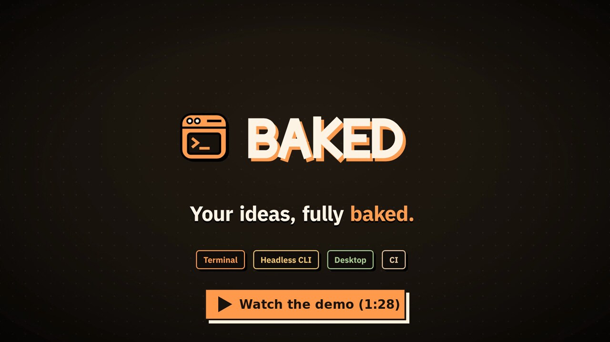</a>

# BAKED

**A coding agent that knows your code's structure, asks before it writes, and keeps its work on your machine.**

BAKED reads your repository through language servers and tree-sitter, so it moves through code by symbols and imports instead of grepping raw text. It edits files, runs your checks and commits, asking first whenever it is about to write. Sessions, memory and workflow state stay local in SQLite.

<picture>
  <source media="(prefers-color-scheme: dark)" srcset="docs/assets/screenshots/chat-dark.png">
  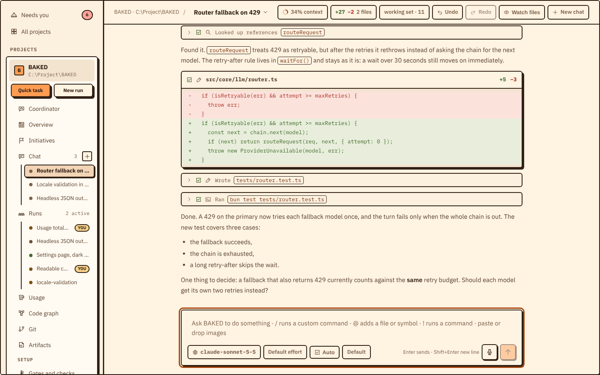
</picture>

> **Status: pre-release.** Releases are published on [GitHub](https://github.com/Gulliby-development/baked/releases) only, not on npm.

## What you can do with it

- **Start from the coordinator.** Each project opens on its coordinator: describe an idea, and it suggests a workflow, splits big work into parallel runs and keeps an eye on each one.
- **Chat with an agent about your code.** Ask a question or a change; BAKED finds the right files, shows each edit as a diff, and you can undo any turn. Pick how much it may do on its own (Manual, Auto or Full access) and its mode (Default, Architect or Plan first) per chat.
- **Hand off a whole feature.** A workflow run goes through research, spec, plan, implementation, checks and review on its own, and stops only where it needs your decision.
- **Keep several projects going at once.** Each open folder is a project with its own chats, runs and settings; *Needs you* collects everything waiting for an answer.
- **Plan big ideas as initiatives.** An initiative splits an idea into features, each with its own workflow run, budget and progress.
- **See your codebase, your Git and your spend.** A live code graph shows how folders and files depend on each other; the Git screen stages, commits, pushes and switches branches over a commit graph; the usage screen shows tokens and cost per stage and model.
- **Use the model you already pay for.** Claude, OpenAI, Codex, GitHub Copilot and GitHub Models are supported ([providers](docs/providers.md)).

BAKED comes as a **desktop app**, a **terminal app**, and a **headless CLI** for scripts and CI. All three run the same agent.

## Screenshots

<table>
  <tr>
    <td width="50%">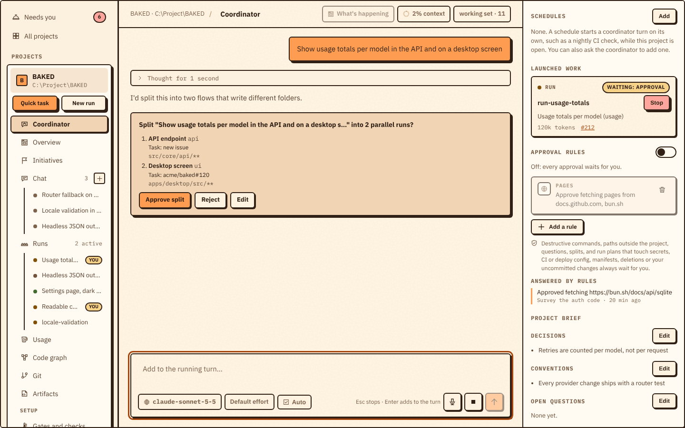<br><b>Coordinator.</b> Describe an idea; it proposes a split, launches the runs and tracks them on the right.</td>
    <td width="50%">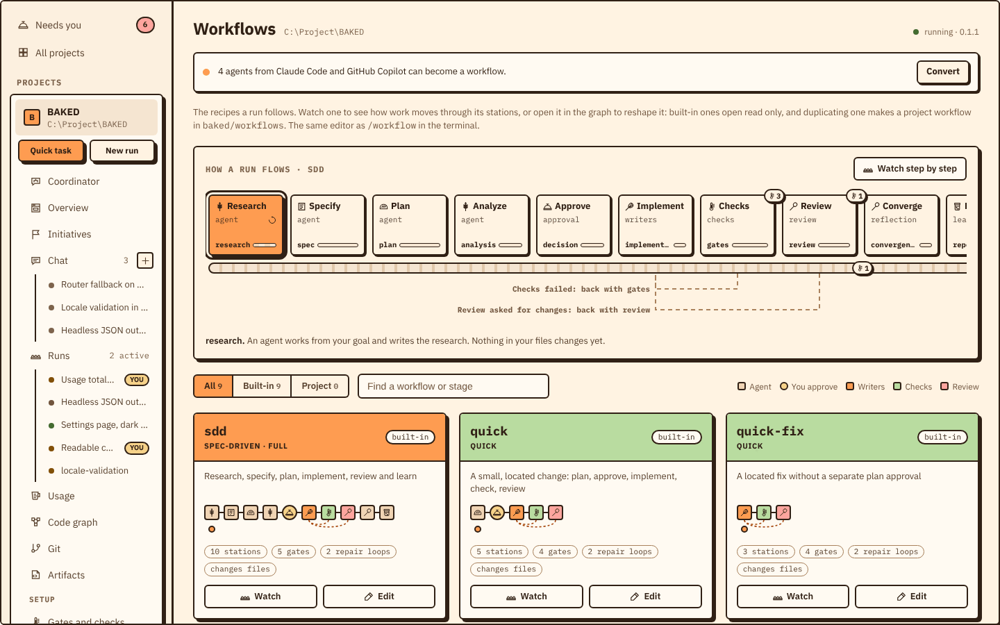<br><b>Workflows.</b> Watch how a run moves station by station, or open a workflow in the editor.</td>
  </tr>
  <tr>
    <td width="50%">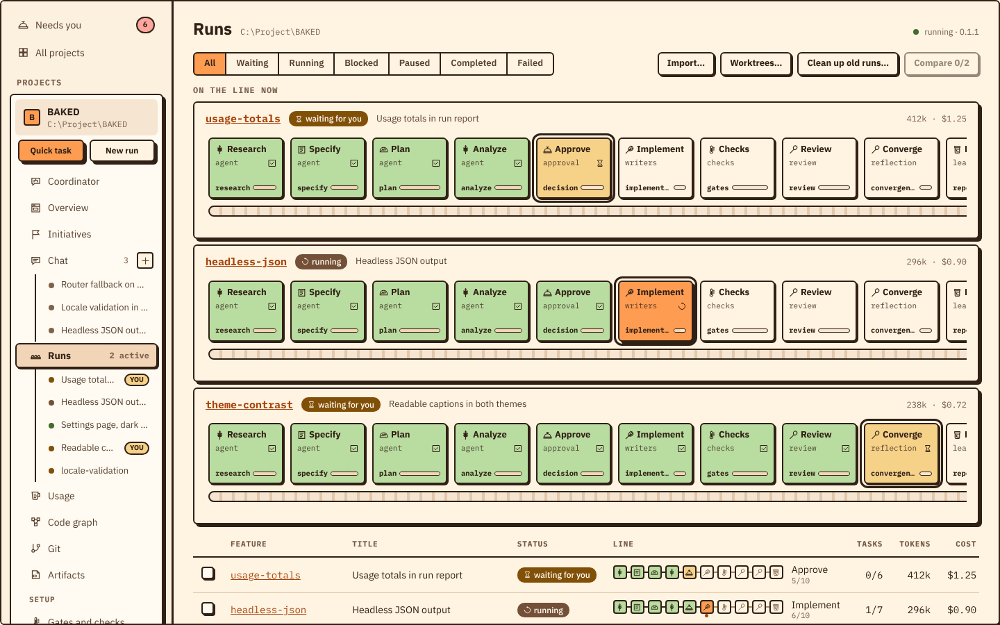<br><b>Workflow runs.</b> Every stage on one line; the run waits for you only where it has to.</td>
    <td width="50%">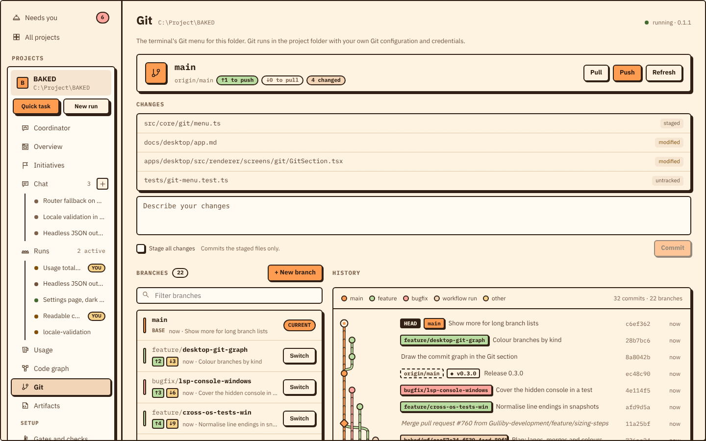<br><b>Git.</b> Changes, commit, push and pull, branches by kind and the commit history.</td>
  </tr>
  <tr>
    <td width="50%">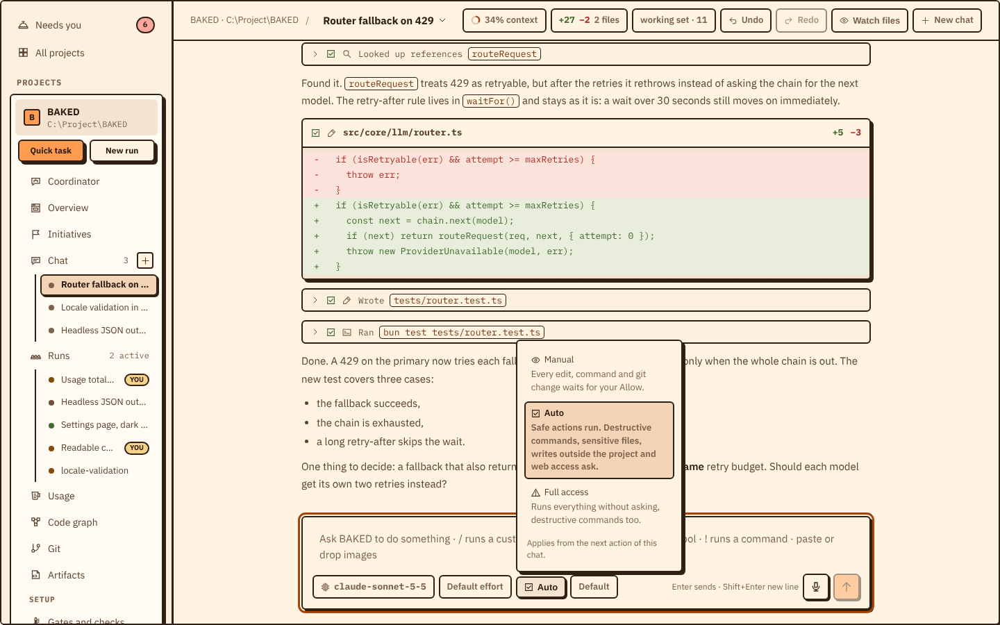<br><b>Permission modes.</b> Manual asks for every edit and command, Auto asks only for risky ones, Full access asks for nothing.</td>
    <td width="50%">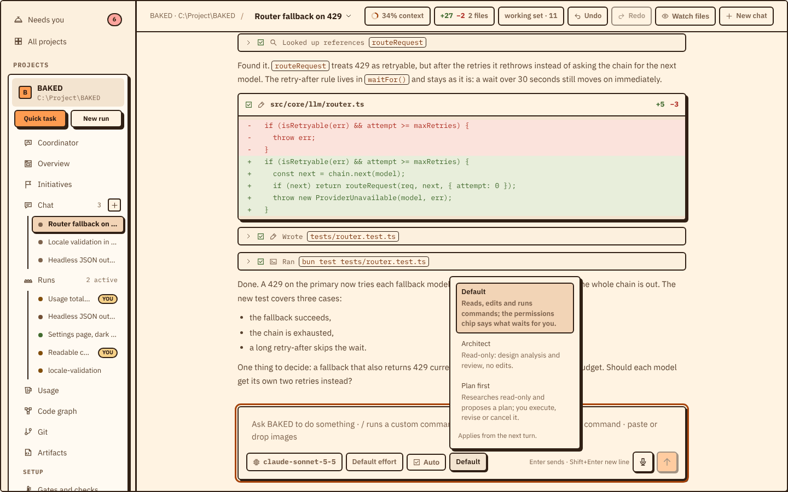<br><b>Agent modes.</b> Default edits and runs, Architect stays read-only, Plan first proposes a plan before acting.</td>
  </tr>
  <tr>
    <td width="50%">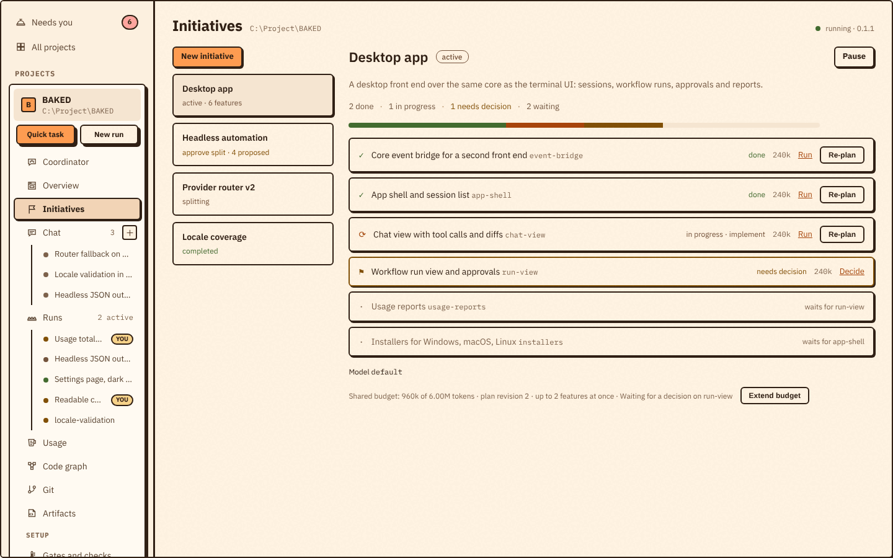<br><b>Initiatives.</b> A big idea as features, each with its own run, size and state.</td>
    <td width="50%">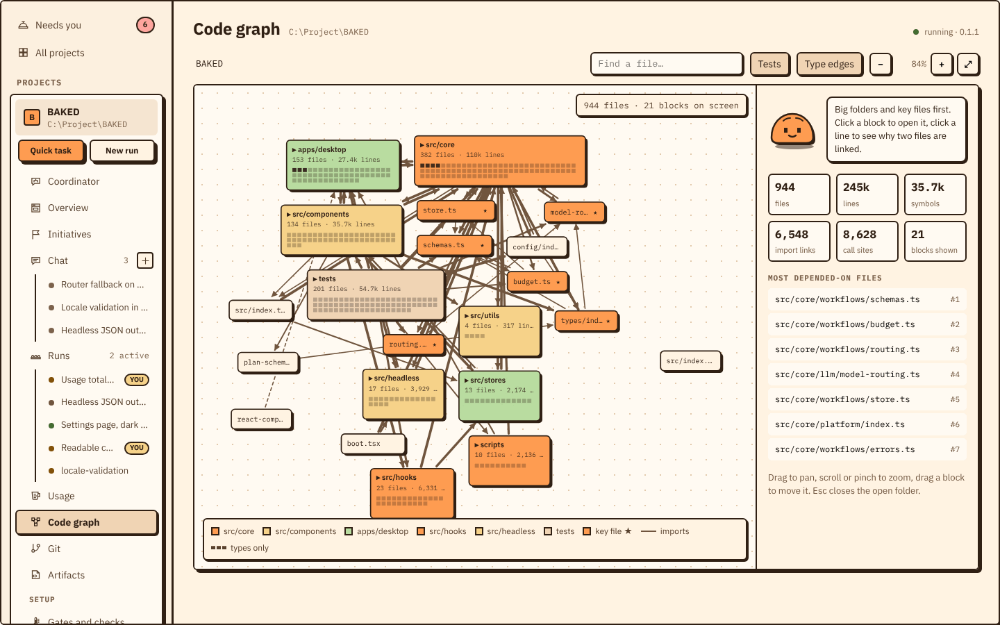<br><b>Code graph.</b> Folders, key files and the links between them.</td>
  </tr>
  <tr>
    <td width="50%">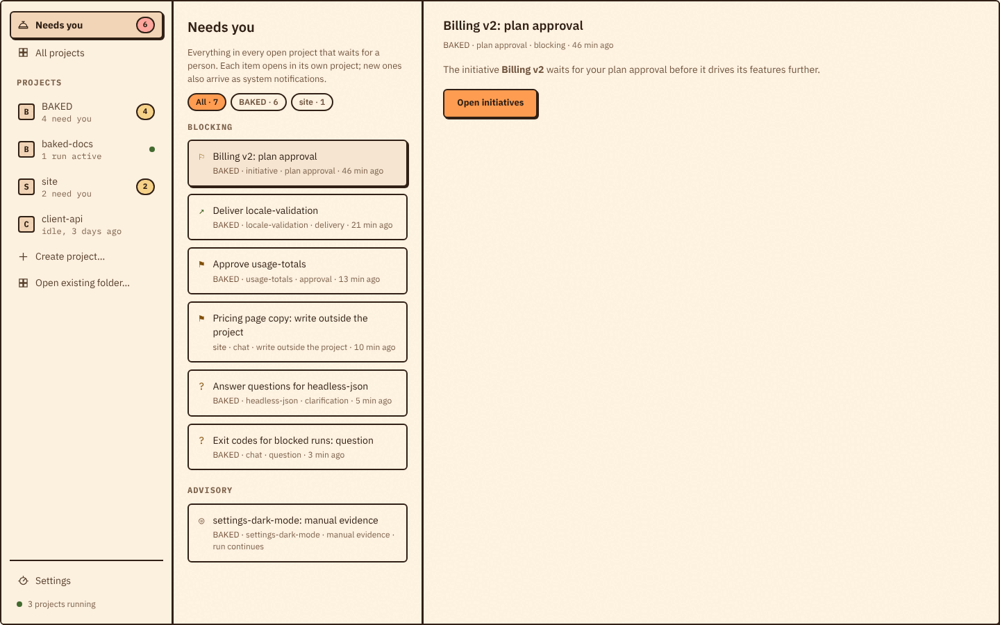<br><b>Needs you.</b> Approvals and questions from every open project in one list.</td>
    <td width="50%">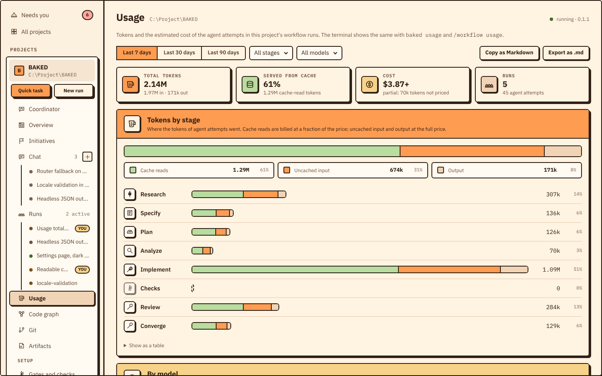<br><b>Usage.</b> Tokens, cache hits and cost by stage and by model.</td>
  </tr>
</table>

Screenshots show the desktop app with sample data.

## Install

Download your platform's file from [Releases](https://github.com/Gulliby-development/baked/releases). While the repository is private, sign in to GitHub first, or use the GitHub CLI (`gh release download --repo Gulliby-development/baked --pattern '<file>'`).

| | Desktop app | Terminal app and CLI |
| --- | --- | --- |
| **Windows** | `baked-desktop-<version>-win-<arch>.exe` | `baked-setup-<version>-x64.exe`, or the `.zip` |
| **macOS** | `baked-desktop-<version>-mac-<arch>.dmg` | `baked-<version>-darwin-<arch>.tar.gz`, then `./install.sh` |
| **Linux** | `.AppImage` or `.deb` | `baked-<version>-linux-<arch>.tar.gz`, then `./install.sh` |

The desktop app bundles its own `baked`, so you don't need both.

<details>
<summary>Unsigned installers, checksums and install details</summary>

- The installers are not signed yet. Windows SmartScreen warns on first launch (More info, then Run anyway); macOS blocks the app until you allow it in System Settings, Privacy & Security. See [Desktop app](docs/desktop/app.md).
- On Linux and macOS, `install.sh` from the extracted archive installs to `~/.baked/bin`. On Windows you can also extract `baked-<version>-windows-x64.zip` and run `baked.exe`.
- Each release lists `SHA256SUMS.txt` for the archives.

</details>

<details>
<summary>Run from source</summary>

Use Bun 1.3.13 or newer on Windows, macOS or Linux:

```sh
bun install
bun run dev
```

From source, replace `baked` in the commands below with `bun run src/boot.tsx`. The desktop app has its own setup in [apps/desktop](apps/desktop/README.md).

</details>

## Get started

1. Open the desktop app and choose **Open folder...**, or run `baked` in your project folder.
2. Connect a model provider: in the desktop app under **Settings, Providers and keys**; in the terminal with `/keys`, then `Ctrl+L` to pick a model.
3. Ask for something, for example *"Explain how requests are routed"* or *"Add a --json flag to the export command"*.

```sh
baked                                     # terminal app
baked --headless "Explain this project"   # one prompt, no UI
baked workflow --help                     # spec-driven workflows
baked doctor                              # check keys, models and tools
```

The [getting started guide](docs/getting-started.md) covers the essentials and shortcuts; settings are in the [configuration reference](docs/configuration.md).

## Privacy

Your prompts and code go only to the model provider you choose. Anonymous usage events (version, OS, surface) are written to a local file and are not sent anywhere unless you set up a receiver; turn them off with `"telemetry": false` or `DO_NOT_TRACK=1`. Details: [privacy and telemetry](docs/privacy.md).

## Documentation

- [User guide](docs/guide.md) and [commands and keys](docs/commands.md)
- [Desktop app](docs/desktop/app.md)
- [Headless CLI](docs/headless.md)
- [Spec-driven workflows](docs/workflows/README.md)
- [Providers](docs/providers.md), [tools and code intelligence](docs/tools.md), [extensions](docs/extensions.md)
- [Troubleshooting](docs/troubleshooting.md)
- [All documentation](docs/README.md)

## Contributing

<details>
<summary>Checks, repository layout and developer docs</summary>

Run these before opening a pull request; CI runs the same:

```sh
bun run lint
bun run typecheck
bun run test
bun run build
```

| Path | Purpose |
| --- | --- |
| `src/boot.tsx` | Startup and CLI routing |
| `src/components/`, `src/hooks/`, `src/stores/` | Terminal UI and state |
| `src/core/agents/`, `src/core/tools/` | Agent execution and tools |
| `src/core/intelligence/` | Code graph, LSP, tree-sitter, TypeScript analysis |
| `src/core/llm/`, `src/core/prompts/` | Providers and prompt assembly |
| `src/core/workflows/`, `src/core/specs/` | Durable workflows and artifact validation |
| `src/core/memory/`, `src/core/sessions/` | Persistent context and conversations |
| `src/headless/` | CLI automation |
| `src/core/api/` | Local workflow API (`baked serve`) |
| `apps/desktop/` | Desktop app (Electron) |
| `docs/` | Documentation |
| `tests/` | Bun tests |
| `scripts/`, `packaging/` | Build, bundle and installer tooling |

- [Development guide](CONTRIBUTING.md): architecture and extension points.
- [Architecture](docs/architecture.md) and [desktop API](docs/desktop/api.md).
- [Agent instructions](AGENTS.md): conventions and checks for any coding agent working on this repository.
- [Telemetry receiver](telemetry-worker/README.md): optional Cloudflare Worker that collects events.

</details>

## License

[MIT](LICENSE)
