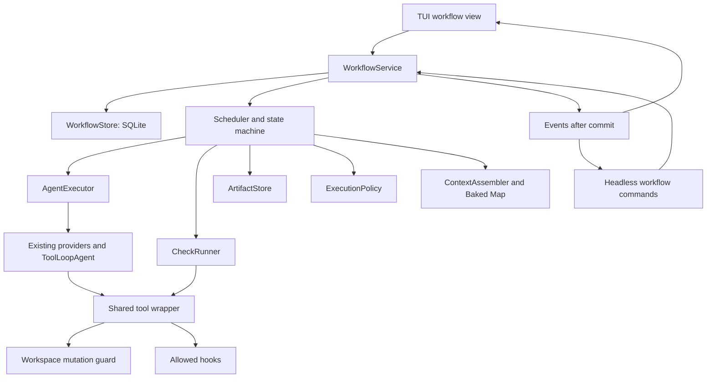
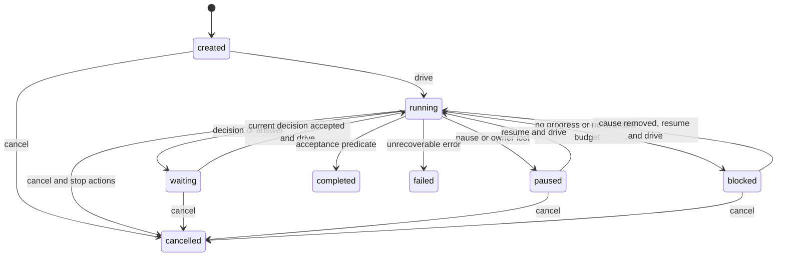

# Workflows and spec-driven development architecture

Design version: 1.0. Status: implemented (v1 runtime). Later changes are in [Workflow v2](v2-design.md); operation is in the [runtime guide](runtime.md). The schemas and storage described here live in `src/core/workflows/schemas.ts` and `src/core/workflows/migrations/`.

## 1. Decision and delivery boundaries

BAKED gets a WorkflowService in TypeScript/Bun. The service keeps its state in a separate SQLite database, executes stages through the existing models and tools, verifies results and offers the same API to the terminal interface and the headless CLI. The first process is called `sdd`. It takes a feature from a request to a verified implementation.

The delivery includes specifications, a task graph, agent profiles, review, requirement coverage checks, bounded repair loops, user decisions, recovery after a stop, an event journal and import of portable artifacts. The ordinary chat and the existing plan mode stay available.

In the first version, one process works in one workspace. One workflow executes in a workspace at a time; other runs may exist while waiting. Research and review inside the active run may be parallel. One mutating agent runs at a time. Multiple worktrees, a distributed scheduler, a background daemon, arbitrary executable plugins, remote workflow workers and automatic commit/push are not part of v1.

SDD ends with confirmation of the engineering criteria. Post-release metrics are stored as deferred and listed explicitly in the result. Completion does not mean publication, a human PR approval or reaching business metrics.

## 2. Original architecture and required fixes

| Code today | Use | Change |
| --- | --- | --- |
| [Bake](../../src/core/agents/bake.ts) | Assembling context, models and tools | Add a restricted execution context; do not put the scheduler into prepareStep |
| [dispatch](../../src/core/agents/subagent-tools.ts) and [runner](../../src/core/agents/agent-runner.ts) | Executing child tasks | Extract AgentExecutor; separate the transport result from task acceptance |
| [AgentBus](../../src/core/agents/agent-bus.ts) | Cache and local coordination | Use it inside an attempt; do not keep durable run state in it |
| [Verifier](../../src/core/agents/agent-verification.ts) | Existing checks | Extract CheckRunner and a typed ReviewResult; keep a text formatter for the old dispatch |
| [Interactive tools](../../src/core/tools/interactive.ts) | Saving plan.md and the review callback | The workflow writes its own artifacts and requests; do not convert the legacy plan automatically |
| [useChat](../../src/hooks/useChat.ts) | UI callbacks and plan continuation | The workflow hook only displays snapshots/events and sends commands |
| [Headless](../../src/headless/run.ts) | Preparing providers and context | Extract a shared runtime bootstrap; add a workflow action |
| [Task list](../../src/core/tools/task-list.ts) | In-memory scratchpad | For workflows, show a projection of durable tasks; forbid the model from setting verified |
| [Sessions](../../src/core/sessions/types.ts) | Conversation and tabs | Add an optional workflowRunId; a run exists independently of a session |
| [MemoryDB](../../src/core/memory/db.ts) | Bun SQLite and project memory | Reuse the way the DB is opened; a new DB with its own migrations |
| [WorkspaceCoordinator](../../src/core/coordination/WorkspaceCoordinator.ts) | Tab warnings and claims | Add a shared mutation guard for every change path while a workflow is active |
| [Tools](../../src/core/tools/index.ts), [hooks](../../src/core/hooks/runner.ts) | Executing actions and extensions | One policy wrapper for Bake, subagents, checks and workflows |
| [cwd](../../src/core/cwd.ts), [boot](../../src/boot.tsx) | One cwd per process | Do not switch cwd for parallel tasks |

Fix the following contracts before enabling workflows:

1. `AgentResult.success` reports only that the call executed successfully. Call success, the presence of useful partial output, the fact of changes and task acceptance are separate fields. Partial output does not open the dependency gate.
2. `task_list` does not get `done` on an error with salvaged output. In a workflow, a task becomes `implemented` after a valid result and verified effects; only the acceptance service sets `verified`.
3. Any non-zero exit code of a required typecheck/test is a failure. An error outside the changed files does not turn into a pass. A pre-existing error is kept as a baseline failure, and the required check stays failed.
4. A missing UI callback does not replace a human decision. The workflow creates a pending request. Automatically choosing the first answer is forbidden.
5. A repeated code agent after zero edits does not apply to `already_satisfied`. That result requires evidence and the usual subsequent check.
6. Approval callbacks, tab/run identity, hooks and path access must work the same way through the main and the lean subagent tools. The existing `codeBase` with a short read/edit/done does not set the limits of workflow profiles.
7. The workflow does not use the clearable `.baked/dispatch` as the only place where evidence is stored.

## 3. System requirements and acceptance criteria

| ID | Requirement | Verifiable result |
| --- | --- | --- |
| W01 | A process has a version, a stage and a status | After a restart, the same finished stages and expected decisions are visible |
| W02 | Requirements have stable IDs and criteria | An unknown ID, a duplicate or an uncovered criterion blocks approval |
| W03 | The task graph is valid | A cycle, an unknown dependency and a self-dependency are rejected before execution |
| W04 | Roles have enforced restrictions | A reviewer cannot change sources through edit, shell, MCP or a hook |
| W05 | Completion relies on evidence | completed cannot be reached with a failed/inconclusive required check |
| W06 | Repairs are bounded | The budget and repeated findings stop new calls |
| W07 | An approval applies to specific data | Changing the spec, plan, original task graph or policy requires a new approval; bounded corrections are checked against the accepted rule |
| W08 | An interruption keeps uncertainty | An unknown shell effect after a crash is not repeated automatically |
| W09 | The TUI and CLI have the same semantics | One scenario gives the same statuses, requests and evidence IDs |
| W10 | Workspace changes are tracked | A check on an old snapshot does not close a criterion for a new snapshot |
| W11 | Decisions and costs are observable | Attempts, checks, stop reasons and usage accounting are available by run ID |
| W12 | User files are preserved | Initial dirty changes and new external edits are not rolled back automatically |
| W13 | Extensions do not execute on import | Import creates a preview and a lock manifest; scripts/hooks stay disabled |
| W14 | Context is bounded and relevant | A task gets its related requirements and dependency inputs; a reviewer gets a fresh context |
| W15 | Requirements can be changed explicitly | revise creates a new revision with invalidation; a terminal run stays history |
| W16 | Large initiatives are supported | Feature dependencies are bound to published contracts and their hash |

## 4. Components and boundaries



WorkflowService does not import React, components, Zustand or CommandContext. The runtime receives adapters for model resolution, tools, logging and context. UI stores are projections. The existing imports of `stores/errors` and `stores/model-events` in agents are gradually closed behind an EventSink interface; the whole of Bake is not rewritten for this change.

AgentExecutor accepts `ExecutionContext { workspaceRoot, runId, stepId, attemptId, ownerEpoch, policy, signal, eventSink }`, the selected profile and an input manifest, and returns a validated result plus the actual effects. Workflow task IDs are always strings. The legacy dispatch adapter keeps accepting numeric task_list IDs separately.

Only the scheduler changes stages. An agent returns a proposed artifact, findings or an implementation result. It does not call start/resume/approve, does not rewrite SQLite and does not create recursive dispatch. This prevents child calls from bypassing the shared budget.

## 5. Formats and source of truth

The shapes of Spec, TaskGraph, Profile, WorkflowDefinition, RunPolicy, Review and ImplementationResult are defined in `src/core/workflows/schemas.ts` and the domain modules next to it.

Versioned part of the project:

```text
specs/constitution.md
specs/<feature-id>/spec.json
specs/<feature-id>/spec.md
specs/<feature-id>/plan.md
specs/<feature-id>/tasks.json
specs/<feature-id>/tasks.md
baked/workflows/<id>.json
baked/agents/<id>.json
baked/checks.json
baked/imports.lock.json
```

Local state:

```text
.baked/workflows.sqlite
.baked/workflow-runs/<run-id>/blobs/<sha256>
.baked/workflow-runs/<run-id>/exports/
.baked/workflow-runs/<run-id>/tmp/
```

The `baked/` directory is chosen for shared definitions because `.baked/` is already gitignored. Global user profiles are allowed in `~/.baked/agents/`; the runtime does not scan arbitrary directories of other products.

`spec.json` is the canonical structured representation of requirements. `spec.md` is generated from it. This refinement of the earlier proposal is needed for stable addressing of criteria, import and schema validation. `plan.md` is the canonical text of technical decisions. `tasks.json` is the canonical task definition; `tasks.md` is generated. Runtime statuses are not written automatically into the Git-tracked tasks.md. The export-progress command creates a separate report.

Editing generated Markdown is detected by hash. The UI offers import-edit as a candidate revision; the agent does not overwrite manual edits. JSON and Markdown are never merged by last-write-wins. Unknown JSON fields are rejected. A round-trip import/export must keep the IDs and the order of requirements.

The JSON hash is computed over UTF-8 canonical JSON: object keys are sorted recursively, array order is kept, undefined and NaN are forbidden. The Markdown hash is computed over the exact bytes. SHA-256 gives the content hash; timestamps do not take part in identity. Escaping and line breaks are normalized only by the renderer, not when checking someone else's changed file.

InputManifestSchema records the hashes of the workflow, policy, profiles, skills, instructions, constitution, spec, plan, task graph and dependency contracts. Before the corresponding artifact exists, its nullable field is null. The root graph is stored after approval; the effective graph changes only through a chain of corrections or a new accepted revision. inputHash is the hash of the canonical manifest. stageRevision stores the candidate manifest and referenced artifacts without changing the accepted inputs; revise accepts only a stored candidate hash after checking its completeness and origin.

Feature/profile/workflow IDs pass SafeId and cannot become a path. Task IDs are unique within a feature, starting with T001. After removal or supersession, an ID is not reused. Requirement IDs FR/NFR/SC and AC are unique within a feature. Cross-feature references use `featureId#ID`.

A `create` task may reference a file that does not exist yet. The current dispatch logic that removes missing targets must not be applied to these tasks. The presence of parents and the permission of the path are checked separately.

Every task has at least one requirement and criterion. A preparatory task also explains its relation to behavior. A graph has at most 500 tasks per revision. A corrective task references finding IDs; its file change does not extend inScope automatically.

## 6. SDD stages

| Stage | Input | Result | Transition condition |
| --- | --- | --- | --- |
| research | Request, active instructions, project index | Research report with paths, constraints and unknowns | A valid report; a blocking question creates a request. The step and token limits scale with the files the request names (see the runtime guide); check outcomes are never blocking unknowns |
| specify | Request and research | Spec candidate | Valid IDs and criteria; questions are explicitly marked blocking |
| plan | Spec and project architecture | plan.md and a TaskGraph candidate | The result parses and refers to the specification hash |
| analyze | Spec, plan, graph, constitution | Deterministic consistency report | No cycles, dangling refs, uncovered criteria or blocking questions. Policy checks are the authoritative verification; missing check outcomes are not findings |
| approve | The full package of requirements, scope, policy and models | Decision with a digest | A human accepted exactly this digest |
| task-graph | Accepted tasks and their dependencies | Implemented tasks and task checks | All executable tasks satisfy the implementation contract |
| checks | Frozen workspace snapshot | Feature checks | All required checks passed |
| review | Spec, diff/baseline, checks, snapshot | Review and findings | No blocking findings and no unavailable mandatory review dimensions |
| converge | Spec, plan, tasks, current behavior | Criterion coverage and corrective tasks | All engineering criteria pass; the others are explicitly deferred |
| learn | Outcome and confirmed fixes | Optional project memory candidate | A memory error does not cancel a verified implementation |

Research report v1 contains `summary`, `facts[{statement, paths}]`, `unknowns[{question, blocking}]`, `constraints[]`, `suggestedScope[]`. A plan result contains `markdown` and `taskGraph`. The shapes are defined by ResearchSchema and PlanSchema; every path is additionally checked against the workspace. They cannot contain executable config. One result is limited to 256 KiB. The plan Markdown must contain the sections Context, Decisions, Components, Data, Verification and Risks; an empty section explains why no data applies. Decisions have IDs like DEC-001 and reference requirements. TaskGraph.planHash is the hash of the exact UTF-8 Markdown from the plan result.

Analyze performs structural checks automatically. A separate spec-reviewer profile with the planner role and output=analysis looks for semantic contradictions. AnalysisSchema returns a verdict and findings with references to input artifacts; the result counts against the budget and is written to the report. If this pass did not run, the stage is inconclusive and approval is unavailable. The built-in analyze uses a new attempt and a new context.

A new blocking question moves the run to waiting until it is answered. The built-in process allows at most 5 questions per request, with text and options; a free-form answer is kept. The absence of an answer does not mean consent.

WorkflowDefinition v1 defines the ordered stages of the mandatory SDD process. approve/checks cannot be removed and an arbitrary script cannot be inserted. `checks.repairTo`, `review.repairTo` and `converge.repairTo` point to task-graph. These are the only backward transitions. An optional final learn is allowed. Configuring profiles and checks covers the v1 use cases; an arbitrary workflow graph is postponed to schema version 2. A DAG exists at the task level already in v1.

## 7. State machine and the completion command



`drive` owns execution until waiting/paused/blocked/terminal. `start` only creates a run, `resume` prepares it for drive and `decide` applies an answer. The UI may call drive automatically after an explicit resume/decision. CLI run/resume calls drive in the same process. After the process exits, there is no background continuation.

Waiting has a pending request. Paused means a user pause or the need to recover the owner. Blocked means a known removable cause. Failed applies to corrupted storage, an unsupported format version or another unrecoverable run error. A provider failure after retry gives blocked/provider_unavailable. Budget exhaustion gives blocked/budget_exhausted. A timeout of one required check gives inconclusive and blocked/verification_failed. Cancelled, failed and completed are immutable; continuation happens through a fork into a new run.

The run revision increases on every accepted mutation command and scheduler transition. The event seq increases on every durable event. Therefore seq and revision need not match. Commands apply compare-and-swap on expectedRevision. Repeating a commandId with the same request hash returns the previously stored result before the revision is checked. The same commandId with a different body gives COMMAND_CONFLICT.

A step instance has a stageId and a generation. A new pass of a loop creates a new instance and attempts and keeps the previous one. Task-graph creates child steps with parent_step_id and stageId `task-T001`; review dimensions use `dimension-correctness`, the skeptic uses `skeptic-` and the first 24 characters of the finding hash. These prefixes are reserved and not allowed in a user definition. The generation increases for every repeated call of such a child stage in a run. Transport retries of one instance have an increasing ordinal. Task states reflect the execution of the current definition. A definition change keeps the old artifact and event, then increases the generation and sets invalidated/pending.

A task dependency opens only when the predecessor is implemented and all of its required task checks passed. After overall acceptance, tasks move to verified. A predecessor error blocks descendants but does not turn them into failed. When a predecessor changes, dependent implemented tasks are invalidated and require a repeated check. An implementation is not repeated without analyzing the changes already made.

The service computes the acceptance predicate in one transaction after re-checking the snapshot:

```text
valid human approval root and valid correction chain authorize current inputs
AND no pending request, unknown effect or invalidated required stage
AND all tasks implemented or verified
AND all required task and feature checks passed on accepted snapshots
AND all required review dimensions completed without blockers
AND all in-scope engineering criteria have current passing evidence
AND all post-release criteria are explicitly deferred in accepted spec
AND workspace and input fingerprints still match
```

After that, tasks become verified, the run becomes completed and a completion report is stored. A token limit after the last necessary answer does not prevent computing the predicate locally and completing. Learn first stores a candidate with category=gotcha or decision, source=agent, project scope and evidence references. The user can accept the candidate through the existing memory UI. In v1, learn does not start an additional model and does not write global rules automatically. The candidate is built from a confirmed finding/repair result pair without an invented cause; when data is insufficient, learn is skipped. A learn error stays a warning.

The scheduler algorithm for one drive:

```text
acquire execution lease; recover interrupted attempts
load pinned definition, profiles, policy and effective input manifest
repeat:
  process pending trusted commands; check cancellation and active deadline
  validate lease owner and budget reservations
  if required decision is pending: persist waiting, release leases, return
  select earliest unfinished stage instance
  for task-graph: select dependency-ready task, never hold a slot while waiting
  commit step/attempt start and reserve resources
  run executor outside the database transaction
  reconcile effects; parse result; validate references and input hashes
  commit attempt result, usage, artifacts and state events atomically
  if input changed: invalidate affected stages and pause
  if repair is eligible: append authorized tasks and create new generation
  otherwise advance, wait or block according to the typed result
  when convergence passes: recheck snapshot and acceptance, commit completed
release leases only after owned processes have stopped
```

SQLite transactions stay short: model calls, hash reads, filesystem writes and child-process waits run outside them. Before a result is committed, compare-and-swap checks the run revision and the attempt inputHash; a late result of an old revision is stored as a historical artifact but does not close the current stage.

## 8. Storage, transactions and file publication

The migrations in `src/core/workflows/migrations/` define the physical schema. SQLite stores runs, instances, attempts, task projections, artifact versions, evidence, findings, requests, effects, leases, events and command deduplication. JSON fields pass Zod and semantic checks before they are written. SQL CHECK does not replace schema validation.

The DB is opened with WAL, foreign_keys=ON, synchronous=FULL and busy_timeout=5000. A migration runs in BEGIN IMMEDIATE and records the SQL checksum and version. An unknown newer version is opened only for diagnostic reading. Before an upgrade, make a backup through the SQLite backup API; copying one file with a live WAL is not allowed. This delivery does not change the memory DB and sessions migrations.

A state mutation, its event, the event_seq update and the command result are written in one transaction. Subscribers receive the event after commit. Delivery is at-least-once; the consumer deduplicates by runId/seq. A notification failure does not lose a committed event. SQL events are append-only in the ordinary API; explicit terminal-run GC may remove a whole history.

Inline content is stored in SQLite for texts up to 256 KiB. Large allowed logs/blobs are first written to temp on the same volume, then flushed and renamed by hash; only after that does a transaction create the artifact row. A blob lost before commit is an orphan and is removed by GC. A missing committed blob makes evidence invalid and blocks completion. The hash is checked on read.

Publishing spec/plan/tasks into the working directory uses the effect journal. First store the canonical artifact and a prepared intent with the expected previous hash. Then compare the file, write temp and perform a safe rename. After that, mark applied. If the user changed the file, publication stops with input_changed. A run that has not published a file itself takes as its expected hash the last hash another run published there, but only when the file still matches it and that run is completed, failed or cancelled: a rerun replaces untouched spec files of a finished run. A file still owned by an open run stops the rerun with input_changed naming that run. On restart, compare the current hash with before/after: after means applied; before allows repeating only a deterministic artifact write; a third value requires a recovery decision.

A multi-file publication is not atomic in the filesystem. The manifest in the DB lists the expected versions; approval is unavailable until all publications complete. A remainder after a crash is recovered from the effects. A package assembled from different revisions cannot be approved.

Default sizes: 256 KiB per structured artifact, 2 MiB per text artifact, 10 MiB raw output per check, 100 MiB evidence per run. Logs are captured as streams; the UI receives a tail of up to 16 KiB. Exceeding a cap is marked. The exit status is not lost due to truncation; a missing required part of the evidence for a reviewer gives inconclusive. When the run cap is reached, execution blocks until space is freed or the policy is explicitly increased.

## 9. Workspace snapshots, locks and recovery

The baseline contains the input manifest hash, the Git HEAD when present, the list of tracked and non-ignored files, their content hashes, presence/absence and symlink metadata. Initial dirty/untracked files are marked as user files. Without Git, the same filesystem manifest is used. `.baked`, node_modules and explicitly declared build outputs are not part of the source snapshot, but package manifests, lockfiles, configuration and check definitions are.

V1 chooses strict invalidation. Any change of the source manifest after a check makes feature checks and review stale. Selective reuse by dependency graph is postponed. Task checks may repeat more often; final feature checks run on a shared stable snapshot. For large repositories a hash cache speeds up reading, but final acceptance must check content and not rely only on a watcher or mtime.

Every check records a snapshot before and after. Sources must not change during a read-only check. Allowed generated outputs are declared in check.writes; the `.baked` path is not a universal exception for writing secrets/config. A source change by a formatter is a separate implementation task, after which checks repeat.

Workspace leases have execution and mutation resources. The execution lease prevents two workflow schedulers from executing one workspace. The mutation lease is used by all BAKED edits, compound edits, shell/project/MCP operations with possible effects and write hooks. During snapshots, checks and review, the workflow holds the mutation lease so other BAKED tabs do not change the check source. Ordinary reads are allowed. A waiting tab receives workspace_busy with the owner's name; a warning is not enough.

The owner identity contains the PID, a process-start identity and a random instance ID. Lease TTL 15 s, heartbeat 5 s. The epoch increases on acquisition; the epoch is checked before every managed effect. TTL expiry alone does not allow takeover. The owner's death and the end of its child processes must be confirmed. If that cannot be proven, the run stays paused/owner_lost. PID reuse is handled by the start identity. Process clocks and lease timestamps are checked for jumps; when in doubt, reconcile is required.

An already started shell cannot be stopped only by an epoch change. CheckRunner/ToolExecutor tracks the process tree and waits for it to end before handing out the mutation lease. Use the existing platform kill helpers; cancelling one workflow must not call the global killAllTracked and kill LSP or another tab. P01 introduces scoped process handles per run/attempt.

An external editor or an unattached process does not respect leases. A repeated manifest check detects their edits and does not allow accepting stale evidence. This is cooperative coordination, not an OS sandbox.

Recovery:

1. Acquire the execution lease after checking the owner; read the run definition snapshot, profiles and policy from the DB.
2. Move running attempts of the lost owner to interrupted; treat usage without a final response as unknown and keep the reservation.
3. Reconcile prepared/applied effects with the disk and process identities.
4. A read-only attempt can be restarted with a new ordinal. A file patch is repeated only when the before hash matches and the scope is valid; a matching after hash means the write already happened.
5. A shell/MCP/network mutation with an unknown result becomes unknown. Automatic replay is forbidden. A recovery request offers to record the actual result, repeat with an explicit decision or cancel the run.
6. Check input and workspace hashes. Changes lead to revise/revalidation; finished stale stages are not skipped.

Exactly-once is guaranteed only for accepting a command in SQLite. External effects use a durable intent and reconciliation. The user's workspace is not rolled back automatically. Undo is available separately (`workflow undo`) for the run's uncommitted task edits, per file and only when the current hash matches the run's last after hash; every task edit stores the pre-image it needs.

## 10. Profiles, tools and context

ProfileRegistry looks up the built-in definitions, then global ones, then project-local ones. An override with the same name is shown with its source and hash. The resolved version and full content are frozen in the run; updating the file does not change a running process. Skills are also frozen by hash. Provider credentials are not stored in snapshots.

| Role | Allowed actions | Output |
| --- | --- | --- |
| researcher | Reading, navigation, impact; web by policy | Research report |
| spec-author | Reading and submit_artifact | Spec candidate |
| planner | Reading and submit_artifact | Plan and TaskGraph |
| implementer | Allowed edits and request_check | ImplementationResult |
| reviewer | Reading the snapshot and evidence, submit_review | Review |
| spec-auditor | Reading requirements and code, submit_review | Criterion coverage |

submit_artifact and submit_review do not write an arbitrary path. They validate the type and write a candidate through ArtifactStore. The model has no write access to SQLite, run blobs, policy, profiles, workflows, AGENTS.md, the constitution or the spec, unless the current stage is meant to form the corresponding candidate.

Effective capabilities are computed as the intersection of BAKED global permissions, the user's run policy, the stage profile and the task scope. Neither a skill, project config nor hook output extends this intersection. Tool names are an allowlist only; an unknown tool is forbidden. `auto` in Bake does not lift workflow restrictions. For the legacy chat, its semantics stay the same.

Wrapper order: schema parse; canonical path/tool classification; role/scope check; acquire the needed lease; call the allowed PreToolUse; re-check the input changed by the hook; apply approvals; record the effect intent; execute; record the outcome; PostToolUse. Any deny takes precedence over allow. Mandatory internal gates work even with disableAllHooks.

Arbitrary shell for read-only roles is forbidden. The v1 implementer does not get unrestricted shell either; tests and preparation operations are called by accepted command/check IDs. Git mutations and network writes require a separate allowed action and are not a regular part of sdd. A compound tool first computes its whole write set, then checks permissions. MCP requires explicitly registered capability metadata; an unknown MCP tool is treated as potentially mutating and is unavailable to the profile.

Commands and hooks can do more than their manifest says. A writes declaration is not a sandbox. Only definitions reviewed and accepted by the user may run. Apply buildSafeEnv and the existing secret protection; envNames adds only specific allowed variables, without storing values in the report. Paths are checked by the realpath of parents, symlink/reparse points, the workspace boundary and Windows case rules. `..`, UNC, drive paths, ADS and NUL are forbidden in portable artifacts.

ContextAssembler builds the input separately for each attempt: applicable project instructions, the constitution, the current specification or its related sections, task/dependency outputs, repository facts and a short repair history. A reviewer does not inherit the implementer's parentMessagesRef. Cache sharing is allowed only for identical immutable instructions. Untrusted source text, imports and model output are marked as data.

Context budget: up to 60% of the model context window for immutable inputs and retrieved code, up to 20% for tool history, at least 20% for the answer and a reserve. On overflow, tool outputs and unrelated history are shortened first. The requirements and criteria of the current task are never silently truncated. If they do not fit, the task must be split. A provider without native structured output uses the submit_result tool with Zod validation. An invalid result allows one corrective output retry within the shared budget; then blocked/invalid_output.

Models are resolved by the existing provider registry. A profile can specify `$active`, `$coding` or `$review`; the resolver records a specific provider/model ID before the first call. Replacing an unavailable model requires an explicit policy change and a journal entry; a silent reviewer fallback is not used. A separate reviewer model is optional; a fresh context is mandatory.

## 11. Checks, findings and reflection

CheckRunner accepts an executable and argv, cwd, timeout and an env allowlist. It does not join a shell string. For example, `bun` + `["run","typecheck"]`. A package script remains trusted executable project code and is part of the approval digest through package/lock/config hashes. Automatic package installation in checks is forbidden.

A passed check result requires exit=0, a finished process, a stable source snapshot and stored evidence. A non-zero exit gives failed; a timeout, a failed start, a cancellation and a lost process give inconclusive. A required check never becomes optional on a model's suggestion. Changing the check configuration requires a new approval. For an originally red baseline, the report shows the difference but does not give completed. The user can change the scope/policy with a separate revision that is visible in the history.

Review dimensions in v1: correctness always; security when auth, secret handling, network, process execution, SQL or file access change; language review optional. Policy.reviewProfiles sets the profile IDs for correctness/security/language; the review stage profileId must match correctness. Policy.forceSecurityReview forces security on. The trigger considers semantic signals, not only a regex over file names. When the security area cannot be excluded with confidence, security review is enabled. Every mandatory dimension has its own attempt. A missing answer means inconclusive.

A reviewer returns ReviewSchema. The runtime checks the existence of evidence IDs, the snapshot hash, requirement/criterion refs and the validity of file paths. Evidence is created by tools, CheckRunner or a trusted manual decision. An agent cannot present invented shell output as command evidence. A positive verdict without coverage of the needed criteria is insufficient. Each finding carries a `basis`: `spec` when the request, a requirement or a criterion names the behavior or input that fails, `inferred` when it rests on a standard, convention or edge case the spec does not name. A finding without a basis counts as `spec`.

Finding fingerprint = hash(featureId, requirement/criterion IDs, kind, canonical path, symbol, normalized evidence snippet). The line number is stored in evidence and is not used as the only identity. Different causes at one place are not merged automatically. A doubtful match keeps two records. Original reports are immutable; dedup changes the projection and keeps the source evidence IDs.

Critical/high findings are blockers. To refute one, a separate skeptic attempt with policy.skepticProfileId must return RefutationSchema and provide verifiable counter-evidence. A model's numeric confidence does not close a blocker. When the skeptic fails, the finding stays an inconclusive blocker. A missing/partial acceptance criterion blocks regardless of severity. Medium/low findings outside the criteria are advisory and appear in the final report. A reviewer does not change code.

A failed required check before review can also open a repair round. The scheduler stores the command evidence, creates a confirmed correctness finding and a corrective task for the related tasks and their accepted write paths. The task template contains the check ID, the evidence ID, the requirements and a ban on changing the check policy. For a feature check, the scope is chosen from the changed tasks; if the cause is outside the accepted scope or the check was missing/did not start, the run blocks until the user decides. An inconclusive infrastructure result does not trigger a pointless code repair. A task check failure uses the same repair budget, moves the original task to blocked and creates a repair task without a back dependency on the blocked task. After a passing recheck, the original task becomes implemented and descendants continue. No graph cycle is created.

A repair round creates corrective tasks and repeats task-graph, checks, review and converge on a new snapshot. A convergence round uses the same path but a separate counter and origin. Findings turn into tasks only if they keep the approved scope and authority. A change of a public contract, write scope, check policy or requirement stops the run before a new approval.

The advance authorization of corrective tasks is part of the digest as the bounded-correction rule. The service may only append new tasks to the original graph and may not change their earlier definitions. New tasks reference existing requirements/criteria and confirmed findings and use a subset of the accepted write paths, operations, profile IDs and check IDs. The DAG is validated again. CorrectionSchema records parentDigest, parentGraphHash, newGraphHash, findingIds, taskIds and the round number as an immutable artifact. The effective authorization is a chain from the human approval through valid corrections. The inputHash changes; the human approval digest stays the root of the chain. Acceptance checks the whole chain and the current effective graph hash. Any change beyond this rule requires a new human approval. A separate request.decided on behalf of the user is not created for an automatic correction.

Default limits: 2 repair rounds, 2 convergence rounds, at most 20 corrective tasks in total. No progress: two consecutive passes have the same set of open fingerprints and no new confirming evidence or reduction of unclosed criteria. The run becomes blocked/no_progress. Reaching `maxRepairRounds`, `maxConvergenceRounds` or `maxCorrectiveTasks` with findings still open also gives blocked/no_progress, with a message naming the setting; `workflow extend` raises only tokens, calls and time, so these limits change through `workflow revise` or a fork. A formatting change does not count as progress. A technical provider retry does not count as a reflection round but uses the shared budget.

Converge checks all criteria, including those already marked as met. The agent cannot adjust the spec to the current code. The allowed results for a criterion are pass/fail/inconclusive/deferred. A manual criterion requires a trusted evidence request. A post-release criterion cannot contain an obligation needed for engineering readiness disguised as a business metric; analyze checks this semantically and shows it to a human before approval.

## 12. Decisions, versions and changing requirements

The approval digest binds the workflow definition hash, profile/skill hashes, instruction/constitution hashes, the spec hash, the plan hash, the original task graph hash, the policy hash and the baseline execution configuration. The scope of user permission includes the planned writes and the allowed command IDs. Source content hashes are part of the baseline, but ordinary approved edits do not require a new scope approval. A contradiction with a new baseline triggers revalidation. The only exception for extending the graph without a new human decision is the verifiable bounded-correction chain from section 11.

A decision is accepted only by a host adapter through WorkflowService and is absent from the model tool registry. An API caller does not assign itself the user role with a string. The user's CLI and the TUI handler are trusted origins within the current local trust model. If a remote API appears, authentication is a separate mandatory project.

Approving an old requestId/digest again gives STALE_DECISION. Rejecting a package moves the run to paused with an explanation; it does not revert sources. An answer to a clarification forms a new candidate revision instead of changing the previously accepted artifact. Pending requests of the previous revision become superseded. The answer is appended to the request and the run continues from the earliest stage whose output it invalidates, reusing the outputs before it: an answer to research questions continues with specify (the research report stays valid and its unknowns are marked non-blocking), an answer to spec questions repeats specify, and an answer to analysis findings repeats specify when a blocking finding refers to the spec (`spec.json`, `spec.md` or FR/NFR/AC IDs) and plan otherwise.

`revise` accepts an existing candidate artifact hash, validates the package and invalidates the stages whose input hashes changed and all subsequent stages. V1 uses conservative invalidation from the first changed stage. A change of task text alone also creates a new revision. Executed effects are kept; a new implementer gets the paths that still contain its earlier attempt's edits and must check the current state before new edits. Content the run itself wrote (by the effect journal) is not a create conflict for plan consistency or the implementer and not an outside change for the workspace check.

Raising the token, call or time limits of a run that stopped on its budget is a direct user command (`extend`, B in the panel): it only raises the three limits, is recorded as an immutable `policy-revision` artifact with both policy hashes and the usage, and keeps the stage, the evidence and the scope approval, because those limits are not part of the scope the digest authorizes. Any other budget or policy change goes through a new policy candidate and an approval. A stricter policy applies immediately to the next actions; extending permissions requires a decision. A legacy `/plan` can be imported as a draft plan with a new spec, but its acceptance does not carry over.

## 13. Budget, retries and observability

Default policy: maxConcurrentReadAgents=3, maxConcurrentWriters=1, maxAgentSteps=24, maxAgentCalls=80, maxTotalTokens=800000, maxActiveMs=3600000, maxCostUsd=null. These are starting engineering limits, not an estimate of a task's cost. The token limit was raised from 400000 after measured runs of a one-task feature used 480k–660k tokens and every one stopped for a budget extension at the last stage. The UI shows them before the start. Waiting for a human and paused time do not count toward activeMs; retries, tools, checks and review do.

Before a model call, the service reserves an input token estimate and maxOutputTokens. Concurrent reservations are counted transactionally. With known usage, the reservation is replaced by the actual value. Unknown usage stays reserved and is shown as unknown; after a crash it cannot be reset. Provider billing may differ from the estimate. A hard dollar cap is allowed only with known prices for the specific model; otherwise a start with such a cap is refused; token/time caps stay available.

For a response that exceeds the expected usage, the real number is stored and new calls stop. An absolute billing ceiling cannot be promised for an already started external request. When time runs out, an abort signal goes to all attempts owned by the run, scheduling stops, effects are reconciled, then blocked. Exiting with Ctrl+C gives paused/user_pause after the processes stop; a second Ctrl+C ends the process, and the next start performs recovery.

Transient provider retry: at most 2 additional attempts, exponential backoff of 1 s and 2 s with jitter, respecting Retry-After up to the remaining deadline. SDK retries and outer retries must not multiply; one layer owns retries. Authentication errors, invalid requests and tool denials are not retried as network errors. Mutating tools are not repeated as part of retrying a whole LLM call without reconciliation.

Durable events and exact payload schemas are defined by `EventSchema` in `src/core/workflows/schemas.ts`. All envelopes have schemaVersion=1. New event types require a schema version or a declared reader compatibility. Hidden reasoning tokens, credentials or the full environment are not stored in the journal. UI streaming text/tool progress is ephemeral; meaningful results are represented by artifacts.

Metrics: stage duration, tokens/cost per role, the number of retries and rounds, unclosed criteria, failed dimensions, cache hit counters, the share of recovered interrupted runs and no-progress stops. Telemetry does not receive spec/source/log content. New aggregates are sent only within the existing user telemetry settings.

## 14. API and errors

`WorkflowService` (`src/core/workflows/service.ts`) is the only mutation API. `get/list/events` are available without the execution owner's lease. `drive` checks the workspace identity and acquires the lease. `fork` creates a new run with the parent's accepted artifacts but without carrying over passing evidence before the snapshot is checked. `revise` works only with a non-terminal run. redact/export/GC operations are implemented by a separate ArtifactService and are available only to a trusted host adapter.

A structured error contains `code`, a safe `message`, `runId`, `retryable` and `details` without provider secrets. Codes: INVALID_DEFINITION, INVALID_REFERENCE, CYCLE_DETECTED, VERSION_UNSUPPORTED, REVISION_CONFLICT, COMMAND_CONFLICT, STALE_DECISION, WORKSPACE_BUSY, INPUT_CHANGED, CAPABILITY_DENIED, OUTPUT_INVALID, BUDGET_EXHAUSTED, STORAGE_CORRUPT, ARTIFACT_MISSING, RECOVERY_REQUIRED, RUN_TERMINAL, NOT_FOUND. An expectedRevision conflict returns the current snapshot for a repeated user decision, without automatically repeating the approval.

List uses keyset pagination by created_at/id, limit 1..100. Events accepts afterSeq and returns durable events in ascending order. Reconnection starts from the last confirmed seq. A slow subscriber does not block the scheduler; after its bounded in-memory queue overflows, it re-reads SQLite. Events do not contain whole blobs.

RunSnapshot.verificationState describes the stored evidence relative to the last accepted snapshot: not_verified/current/stale/invalid. This is the historical verification state, not a promise of conformance to arbitrary new files on disk. Status stays read-only. Before resume, evidence reuse or a new acceptance, the service re-checks the workspace content and records invalidation on a mismatch.

## 15. CLI and TUI

CLI routing is added before entering the TUI: `cliArgs[0] === "workflow"`. Do not extend the loose --headless parser for these commands. The workflow parser rejects unknown flags and invalid numeric values. `--cwd` is applied by the existing resolveCwdFromArgv before the config is read.

```text
baked workflow run sdd --feature team-invitations --prompt-file request.txt --json
baked workflow list --json
baked workflow status RUN_ID --json
baked workflow resume RUN_ID --expected-revision 12 --events
baked workflow approve RUN_ID --request REQUEST_ID --digest SHA256 --expected-revision 12
baked workflow answer RUN_ID --request REQUEST_ID --answers-file answers.json --expected-revision 12
baked workflow evidence RUN_ID --request REQUEST_ID --file evidence.txt --accept --expected-revision 12
baked workflow reject RUN_ID --request REQUEST_ID --reason "Change scope" --expected-revision 12
baked workflow pause RUN_ID --expected-revision 12
baked workflow cancel RUN_ID --expected-revision 12
baked workflow revise RUN_ID --candidate SHA256 --expected-revision 12
baked workflow fork RUN_ID --expected-revision 12
baked workflow import spec-kit --source ./existing-spec --feature team-invitations
baked workflow import ecc --source ./reviewed-ecc-checkout --profile planner
baked workflow import-edit RUN_ID --file specs/team-invitations/spec.md
baked workflow export RUN_ID --out .baked/workflow-runs/RUN_ID/exports/report.json
baked workflow export-progress RUN_ID
```

`baked serve` exposes these commands as a localhost HTTP API with a Server-Sent Events stream of the durable events; it builds the same parsed arguments and calls the same command function, so its behavior is the CLI's ([runtime guide](runtime.md#local-api-baked-serve)).

The mutation CLI generates a UUID commandId and accepts `--command-id` for idempotent automation. approve/answer do not start drive by themselves; the next resume command continues execution. In the TUI, drive may continue in the same tab after an accepted decision. `--json` and `--events` are mutually exclusive; stdout contains only machine data and diagnostics go to stderr. Run accepts a prompt or --prompt-file, exactly one source; secrets must not be passed through the example command line.

Exit codes for workflow run/resume: 0 completed, 1 failed/validation error, 2 active deadline exhausted, 3 waiting, 4 blocked, 5 revision/lease/input conflict, 130 paused by Ctrl+C or cancelled during drive. Successful status/list/approve/pause/cancel management commands return 0 and the snapshot regardless of its terminal status. This does not change the exit codes of the legacy --headless. An unexpected EOF while waiting for a decision keeps waiting and code 3.

The TUI contains a WorkflowPanel with the stage, budget and progress of criteria and tasks; a TaskGraphView with dependencies and blocked reasons; an ArtifactReview with the accepted/candidate diff; a FindingsView with evidence links; a DecisionPrompt; and a RunHistory. The commands `/workflow start`, `/workflow status`, `/workflow resume`, `/workflow pause` and `/workflow review` use the same service. Exact completion is shown by criteria; the number of finished agents is secondary.

Closing a tab with a drive offers to pause or move the observation to another existing tab. It does not create an invisible background daemon. Session restore shows the snapshot and offers resume; it does not call the model automatically. Workflow events use runId/attemptId and are not mixed with tab-local numeric task IDs.

## 16. Import, extensions and initiatives

The built-in sdd and profiles ship with BAKED. A project-local workflow in v1 can change profile versions and descriptions but keeps the mandatory stages and transition rules. A preset can reference definitions but does not enable them automatically when the config is loaded. A change is applied after a preview and user confirmation.

| Source | v1 support | Behavior on an unknown field |
| --- | --- | --- |
| Spec Kit spec.md/plan.md/tasks.md | Import into a candidate with sourceRefs and the original artifact | Ambiguity report; further acceptance is forbidden until resolved |
| Spec Kit constitution | Matched against the existing project instructions | The conflict is shown; AGENTS.md is not rewritten |
| Spec Kit workflow YAML | Compatibility report only, no execution | Unsupported steps are listed |
| ECC SKILL.md and agent prompt | A copy of the selected text and an explicit tool/model mapping | Unsupported tools are disabled; the profile is marked incomplete |
| ECC command/agent hooks and JS workflow | Not executed on import | A separate native adapter and review are needed |

The importer accepts a local reviewed checkout or directory. Network download is a separate action with an explicit source and a pinned commit/version. imports.lock stores the source URL, the commit when present, content hashes, the license, the adapter version and the list of unsupported features. Import keeps the MIT attribution when copying ECC/Spec Kit. Do not use a floating main as a runtime dependency. The current external links in this design are references, not a package lock.

Imported Markdown is treated as data; commands from it are not run. Parser limits: 2 MiB per file, 100 files per import, no symlink escape, no archives with path traversal and no unknown encoding. Frontmatter describes metadata but does not grant permissions.

A large initiative creates several feature specs. Each feature stays a separate run and has dependencies with a contractHash. In v1, the initiative manifest is a document with a list of features; automatic global planning across runs is postponed. Before approval, the presence of an accepted contract of the needed version is checked. If an upstream contract changes, the downstream run gets input_changed; old passing evidence is not carried over. Upstream code does not need to be finished to plan the downstream against an accepted contract. Downstream execution starts after the agreed readiness of the dependency, recorded by manual evidence or a completed upstream run.

## 17. Retention, storage errors and operations

Do not remove the evidence of active, waiting, paused and blocked runs. Terminal runs keep metadata/events/artifacts for at least 30 days; automatic removal is off by default. `workflow gc --before DATE --dry-run` shows the volume and dependencies; without dry-run it requires an explicit user command. GC does not remove accepted specs. Redacting a secret creates a redaction record, removes the secret blob and makes the dependent evidence invalid. The terminal status stays the historical completed, but status/export explicitly show the evidence as invalid/redacted and do not present such a run as currently verified. A new acceptance requires a fork and new checks.

Export includes the manifest, versions, decisions, checks, findings and coverage and excludes credentials and internal provider payloads. Export outside the workspace uses the existing outside-cwd approval. Verifiable results can be archived separately from raw agent outputs.

Disk full/SQLite busy: stop scheduling and do not continue changes without the durable journal. Retry busy within the overall deadline; disk full gives paused/storage_failure if the state can be written, otherwise a stderr diagnostic and recovery on the next start. A corrupt DB is not recreated automatically. Show the path and the backup and open a read-only diagnostic flow. WAL on a network filesystem is not supported in v1; a local workspace or a separately reviewed storage is required.

Turning the feature flag off forbids start/drive but keeps status/export available. An active run is paused before the flag is turned off. Old chats, memory and provider profiles are not migrated forcibly.

## 18. Verification and release

Restart/crash scenarios, Windows path/process tests and TUI/CLI parity are mandatory before release. Checking one happy-path feature is not enough.

Rollout: `workflows.enabled` is false by default, so workflows are opt-in. Importers are enabled separately by workflows.importsEnabled. Unifying the wrong success/done and permission propagation ships as a separate fix with legacy regression tests.

The built-in profiles, workflow and migration SQL are included in the Bun bundle as static assets or TypeScript constants. Access to them does not depend on cwd or on a source checkout. The build smoke test runs the built binary from an empty temporary workspace, creates the DB, lists the built-in profiles and checks status without provider credentials. The migration checksum is computed over the same bytes that are in the bundle.

Performance targets are measured separately from LLM latency on a local SSD: p95 status/list at most 200 ms with 1000 runs and 100000 events, the first page of event replay at most 500 ms, steady-state durable event to TUI at most 250 ms. These are criteria for a future measurement, not the result of the current check. status/list requests do not hash the workspace and do not load blobs; snapshot reads are streamed. The cancellation check must show that stopping owned child processes starts within 1 second, followed by a bounded grace period and platform-specific termination. The TUI stays available during hashing, SQLite busy and the termination of child processes.

## 19. Accepted architectural decisions

| Decision | Reason | Consequence |
| --- | --- | --- |
| Bun/TypeScript runtime | Matches the current product | No Python Spec Kit engine is added |
| SQLite + immutable artifacts | Recovery, CAS and evidence are needed | Session JSONL is not a workflow database |
| spec.json/tasks.json + Markdown views | Stable IDs and schema validation are required | Manual Markdown goes through an explicit import-edit |
| One writer and one active run per workspace in v1 | Global cwd and the existing shared tools | Several writers came later with [task worktrees](parallel-worktrees.md) |
| Built-in SDD and a restricted schema v1 | Invariants and bounded repair can be verified | The general workflow graph is [v2](v2-design.md) |
| Evidence-based completion | Agent text does not confirm tests | Unknown/inconclusive blocks a required gate |
| A new version cancels earlier approvals | A decision applies to a specific scope | Resume does not use a stale digest |
| Policies are enforced in tools | A prompt does not restrict real actions | All adapters go through the shared wrapper |

The values of limits and thresholds are proposed defaults and may change after measurements without changing acceptance semantics. Postponed capabilities must not appear in v1 as undocumented hidden extensions.

## 20. Sources and provenance

- [Spec Kit process](https://github.com/github/spec-kit) describes the SDD stages.
- [Spec Kit analyze](https://github.com/github/spec-kit/blob/main/templates/commands/analyze.md) was used for the idea of cross-artifact checks.
- [Spec Kit converge](https://github.com/github/spec-kit/blob/main/templates/commands/converge.md) was used for coverage checks and adding corrective tasks.
- [Spec Kit engine](https://github.com/github/spec-kit/blob/main/src/specify_cli/workflows/engine.py) shows state persistence and resume.
- [ECC review workflow](https://github.com/affaan-m/ECC/blob/main/workflows/orch-review.workflow.js) was used as a model of separate review dimensions and blocker checks.
- [ECC pilot status](https://github.com/affaan-m/ECC/blob/main/workflows/README.md) limits conclusions about the readiness of a portable runtime.
- [ECC continuous learning](https://github.com/affaan-m/ECC/blob/main/skills/continuous-learning-v2/SKILL.md) was used to separate project observations from permanent rules.

This design does not copy external executable workflows. It defines BAKED's own contracts.
