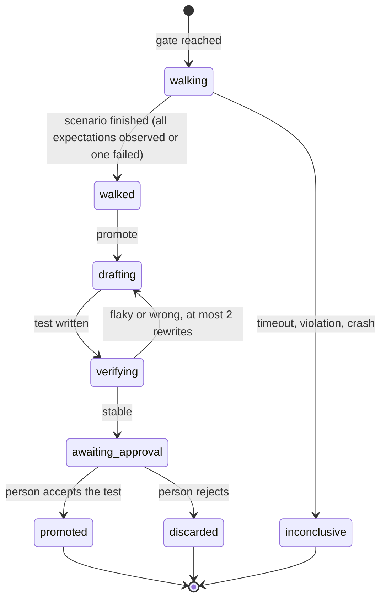

# Workflow v2: technical design

Design version: 0.1. Status: implemented. Operation is described in the [runtime guide](runtime.md); the v1 architecture it extends is in [architecture](architecture.md).

The rules below are enforced in code: `src/core/workflows/v2/definition.ts` holds the schemas and the definition validator (`WorkflowV2Schema`, `GateSchema`, `validateWorkflowV2`), `src/core/workflows/v2/upgrade.ts` reads v1 definitions through the migration function, the built-in presets are in `src/core/workflows/v2/presets/`, and `tests/` covers the validator's rejections.

## 1. Goals and boundaries

Goals:

1. A user runs their own workflow without editing the scheduler: stages, transitions, typed contracts between them and gates on the transitions are data.
2. Five presets ship with BAKED: Quick fix, Standard, Full, Spike and Review only.
3. The built-in `sdd` keeps its behavior exactly. A run stored by v1 continues under the v2 runtime on its stored definition.
4. A stage that changes files can only run after a human approval, unless the user explicitly enabled auto approval inside limits.
5. Gates are a library: command, human, AI review and AI acceptance gates are defined once in `baked/gates/*.json` and attached to transitions in an editor window.
6. An AI acceptance gate can walk a finished feature like a user would, but a model's claim never closes a required gate: the walk-through becomes a deterministic test first.

Not in this document: initiatives and decomposition (section 3 of the plan), Git delivery (section 4) and parallel worktrees ([separate design](parallel-worktrees.md)). Section 12 states what they need from v2. Also out of scope: several writers in one workspace, a daemon, remote workers, executable plugins, arbitrary scripting in conditions, an OS sandbox.

## 2. What v1 gives, and what v2 must not change

The v1 runtime already provides the properties v2 relies on; every one of them is an invariant of this design.

| v1 property | Source | v2 consequence |
| --- | --- | --- |
| One scheduler, one writer per workspace, leases and fencing | [architecture](architecture.md) section 9 | The definition cannot add concurrency; `tasks` stays the only writing stage type |
| Frozen definition, profiles, policy and instructions per run | `input_manifest_json`, hashes | A definition change never alters a started run; it is a revision with a new approval |
| Typed results validated before any use | `outputSchemas` | The contract of a transition is this validation, made explicit |
| Evidence-based completion | acceptance predicate | Gates produce evidence; advisory gates produce evidence that closes nothing |
| Bounded repair | `repairTo`, round counters | Every back edge is a bounded loop; a runtime cap on stage visits backs it |
| Durable requests for every human decision | `requests` table | Human gates and auto approval are recorded the same way |
| Unknown effects are never replayed | effect journal | A gate that runs a command follows the same journal |

Behavior that stays byte for byte: stage order of `sdd`, the repair targets, the round limits from the policy, the approval digest of a stored run, check evidence in `check_results`, the acceptance predicate, the exit codes of the CLI, and the event types and payloads v1 already writes.

## 3. The definition (schema version 2)

The schema is `WorkflowV2Schema` (`src/core/workflows/v2/definition.ts`). A definition is a directed graph of stages joined by transitions. It has one entry stage and one completion node named `done`.

```json
{
  "schemaVersion": 2, "id": "quick-fix", "version": "1.0.0", "preset": "quick-fix",
  "inputs": ["request"], "entry": "plan",
  "stages": [ { "id": "plan", "type": "agent", "profileId": "planner", "consumes": [], "produces": "plan", "effects": "none" }, "..." ],
  "transitions": [ { "id": "plan-approve", "from": "plan", "to": "approve", "on": "passed", "carries": "plan", "gates": [] }, "..." ],
  "limits": { "maxStageVisits": 40 },
  "autoApproval": null
}
```

The complete files are in `src/core/workflows/v2/presets/`.

### 3.1 Stage types

The v1 stage kinds become seven stage types. No type adds a new executor: each is an existing v1 mechanism with a name.

| Type | What it does | Produces | Effects | Outcomes | v1 kinds |
| --- | --- | --- | --- | --- | --- |
| `agent` | A read-only agent submits one typed result | the contract it names | none | passed | research, specify, plan, analyze |
| `tasks` | Runs the approved task graph; the only stage that edits files | `implementation` | `workspace-write` | passed | task-graph |
| `check` | Runs its command gates on a frozen snapshot, no model | `gates` | none | passed, failed | checks |
| `approval` | A decision bound to the digest of the contracts it covers | `decision` | none | passed | approve |
| `review` | Runs its AI review gates, each reviewer in a fresh context | `review` | none | passed, changes_requested | review |
| `reflection` | Covers every criterion; may append bounded corrective tasks | `convergence` | none | passed, changes_requested | converge |
| `learn` | Optional last stage: a project memory candidate | `report` | none | passed | learn |

`effects` is declared, not guessed. At the start of a run the runtime checks it against the profile: an `agent`, `review` or `reflection` profile that carries an editing tool is rejected (v1 already does this per role). The only way to write files is a `tasks` stage inside the approved scope.

### 3.2 Contracts: the typed output of a stage

A contract is a schema name from `ContractId` (`src/core/workflows/v2/definition.ts`). The first eight are the v1 results, unchanged: `research`, `spec`, `plan`, `analysis`, `implementation`, `review`, `convergence`, `refutation`. v2 adds four.

| Contract | Produced by | Notes |
| --- | --- | --- |
| `report` | an `agent` stage with the new `reporter` profile, or `learn` | Findings and a recommendation for a Spike; never a task graph |
| `diff` | the host, at the start of a review-only run | A frozen diff with its hash; an agent cannot submit it |
| `decision` | an `approval` stage | The digest, the actor (`user` or `auto-approval`) and the covered stages |
| `gates` | a `check` stage | The recorded results of its gates |

Every transition names the contract it `carries`; it must equal what the source stage produces. Before the transition is taken the runtime parses the output with the schema, stores its hash and writes `contract.validated`. A downstream stage lists what it `consumes`, and the validator proves that every path from the entry to that stage has produced it. This is what removes the hard-coded knowledge of the scheduler about which stage needs which result.

### 3.3 Transitions

A transition is `from`, `to` (a stage or `done`), the outcome it answers (`on`), an optional `when`, the contract it carries, an ordered list of gates and an optional `loop`.

- `on` is one of `passed`, `changes_requested`, `failed`. Section 3.1 lists which outcomes each stage type can report.
- `when` is one equality on one field of the carried contract, for example `{ "field": "$.verdict", "equals": "pass" }`. There are no expressions, no functions and no scripts. Several conditional transitions for the same outcome must test the same field with different values and need one unconditional fallback.
- `loop` marks a back edge and bounds it: `maxIterations` from 1 to 5. A cycle without a marked edge is invalid.

### 3.4 Validation before a run

The same function (`validateWorkflowV2`) runs in the editor, in `baked workflow validate` and when a run starts. It reports every problem, not the first.

1. Stage and transition IDs are unique; `task-`, `dimension-`, `skeptic-` prefixes and `done` are reserved.
2. The entry, every endpoint and every referenced gate exist.
3. `carries` equals what the source stage produces.
4. Data flow: every consumed contract is produced on every path to the consumer, starting from the run inputs (`request`, or `diff` for review only).
5. Each stage has a `passed` transition; outcomes the stage type cannot report are rejected; transitions for one outcome are deterministic.
6. Every stage is reachable from the entry and can reach `done`.
7. Every back edge found by depth first search carries a bounded `loop`; a loop marker on an edge that closes no cycle is rejected.
8. A `check` stage binds command gates only; a `review` stage binds AI review gates only; a task scope gate only follows a `tasks` stage.
9. The approval invariant of section 5.
10. `maxStageVisits` leaves room for one pass through every stage. At run time it is a hard cap on stage visits for the whole run, so even a valid graph cannot loop forever.

### 3.5 Execution semantics

Position. A run stores its position (current stage, visit counters, loop counters and the hash of each carried contract) in the runtime state artifact. For a stored v1 run the position is derived from `stageIndex`; the two are interchangeable for the built-in definitions.

Skip. A user cannot skip a stage. A stage records the status `skipped` only when its own precondition says there is no work (a security review whose trigger did not fire, `learn` without a confirmed finding pair, tasks that were all `already_satisfied`). The transition is still taken with outcome `passed`. This keeps a skipped gate from hiding in a definition.

Failure. A stage that cannot produce a valid contract after the bounded correction ends the visit as `blocked` with the v1 reason codes (`invalid_output`, `verification_failed`, `tool_denied`, `budget_exhausted`, `provider_unavailable`, `no_progress`). No transition is taken. `failed` as a transition outcome is only a check stage whose required command gate exited non-zero, which a loop edge may route to repair. An inconclusive gate (timeout, spawn error, source changed during the check) is never `failed` and never repaired automatically; it blocks.

Gate failure on a transition. Stage gates (the gates of a `check` or `review` stage) decide the stage outcome. Gates bound to a transition are checkpoints: all required ones must pass before the next stage starts, and a failure blocks the run with `verification_failed`. Repair therefore happens through explicit outcomes and loop edges, and through the v1 per task repair inside `tasks`.

Pause. A pause (user, owner lost, workspace busy) keeps the position. Resume continues the same stage visit with a new attempt; an unknown command effect follows the v1 recovery request.

Cancel. Terminal, as in v1. Owned processes stop, no transition is taken, the run is read only history and `fork` is the way to continue.

Retry. Three layers, kept apart so they do not multiply: provider transport retry inside one attempt (v1, at most 2); the gate `retries` field for one gate (section 6); a loop edge for a repair round. A stage is never retried by simply running it again.

Budget. Everything in section 1a applies per run, not per stage: token and call limits, checkpoints, extension, estimates. The estimator (section 1a) prices stages by ID from history, so a custom stage is priced after its first runs and shown with generic ranges until then.

### 3.6 Changing a definition

A definition is read from `baked/workflows/ID.json` when a run starts and frozen with its hash, exactly like a v1 custom workflow. A change to a started run is a revision: `candidate --workflow FILE` stages it, `revise` applies it after a new approval. The revision is accepted only if the current stage and every stage already completed still exist with the same type, the contracts already produced still satisfy the new consumers and the invariant of section 5 holds. Anything else is rejected with the reasons.

## 4. Presets

Each preset is a file in `src/core/workflows/v2/presets/` and is checked: valid under section 3.4, expected stage list, no write stage in the read-only presets, an approval stage in every preset that writes.

| Preset | Stages | Files change | Gates by default | Use |
| --- | --- | --- | --- | --- |
| Quick fix | plan, approve, implement, checks | yes, after approval | task tests on implement, then typecheck, lint, tests | A small, well understood change |
| Standard | research, specify, plan, analyze, approve, implement, checks, review | yes, after approval | as Quick fix, plus correctness review | The normal feature |
| Full | the current SDD: Standard plus security review, convergence on every criterion and learn | yes, after approval | as Standard, security review when triggered | Large or risky changes |
| Spike | research, report | never | none | Learn something and write it down |
| Review only | review of an existing diff | never | correctness and security review | Check a diff against criteria |
| Fix CI | reproduce, research, plan, approve, implement, verify | yes, after approval | typecheck, lint, tests in reproduce and verify, task tests on implement | Make failing checks pass ([Fix CI](fix-ci.md)) |

Notes:

- Quick fix has no specification stage. Its plan is the whole record, so its approval digest covers the plan and the task writes only.
- Full is equivalent to the v1 `sdd` workflow: `upgradeWorkflowV1` applied to the v1 definition and policy produces the same stages, outcomes, contracts and loop bounds.
- Spike and Review only contain no `tasks` stage and every stage has `effects: "none"`. The new-run form shows "no file will change" for them, and the runtime refuses to attach a writing tool to their profiles.
- The new-run form lists the presets and the user's own definitions, shows the stages and the gates of the chosen one and the spend estimate for it. A preset is a starting point: "duplicate as custom" copies it into `baked/workflows/`.
- Auto approval (section 5.2) is never the default of any preset.
- Fix CI starts with a check stage. When those checks already pass, the run completes without a model call or a change; a run that ends before any `tasks` stage has nothing to accept.

## 5. The approval invariant

**A stage that changes files runs only after a human approval that covers it, unless the user explicitly enabled auto approval inside stated limits.**

### 5.1 Rule and proof

An `approval` stage lists the writing stages it covers (`covers`). The validator searches for a path from the entry to each `tasks` stage that avoids every approval covering it, ignoring back edges. If one exists, or if no approval covers the stage, the definition is invalid. A loop returns to the writing stage through the same approval digest: a repair round may append only the corrective tasks the v1 bounded-correction rule allows, and anything beyond it needs a new approval, as in v1.

The digest of an approval is computed by the host over the contracts it consumes, the effective gates with their modes, the policy limits, the frozen profiles and the workflow definition hash. Changing any of them invalidates the decision (`STALE_DECISION`), as in v1. A human gate cannot substitute for an approval stage: it can ask for more (manual evidence, a typed answer), never for less.

### 5.2 Auto approval

Auto approval exists for users who want a small fix to proceed without waiting. It is off in every preset and is a property of the definition, so it is frozen with the run and visible in its hash.

```json
"autoApproval": { "enabled": true, "maxTasks": 3, "maxFiles": 5, "allowedPaths": ["src/**", "tests/**"],
                  "allowDelete": false, "allowNewDependencies": false, "maxTotalTokens": 800000 }
```

- The approval stage is marked `"decision": "auto"`. The validator rejects an auto approval without limits.
- At the approval point the host (never the model) compares the plan with the limits: task count, the number of distinct files, every write path against `allowedPaths`, deletions, and the token estimate against `maxTotalTokens`. It also requires an analysis verdict of `pass` without blocking findings.
- Always human, whatever the limits: `.git`, `.baked`, `baked/` (definitions, gates, profiles, skills), CI configuration, package manifests and lock files (`allowNewDependencies` is the literal `false` in the schema), `tsconfig*`, `biome*` (creating a manifest or tool config that does not exist yet is allowed; modifying one is not, unless the run started on a workspace without source files, where a scaffold manifest or tool config may be edited too; the host reads this from the first workspace facts the run recorded), `.env*`, `AGENTS.md`, `CLAUDE.md`, key and certificate files, and any change of the gate list or the policy that no operator command made. A renewal of an earlier human approval accepts the policy an authenticated operator command set later (a budget extension, or a revision that changes the policy, each recorded by the host as a `policy-revision` with the user as approver), because that command is the human decision. Capabilities never widen without a person: new write paths, task profiles, tools, network access or weaker review always fall back to a human request, whoever changed them. Human intent is never inferred from model output.
- Inside the limits the host records a `decision` with actor `auto-approval`, the same digest a human would sign and a hash of the limits. Outside them the run waits for a human request exactly as in Standard: auto approval never widens itself and never fails open.
- Turning it on is a human act: selecting or saving a definition that contains it asks for a typed confirmation that names the limits. The run overview shows "approved automatically within: ..." for the whole life of the run and the final report repeats it.
- The agents cannot enable it: definitions are not in the tool registry, and `baked/workflows/` is a protected path for every profile.

## 6. Gates

A gate is one reusable check with a type, a bound and an evidence format. The schema is `GateSchema` (`src/core/workflows/v2/definition.ts`); an example is [examples/ai-acceptance-gate.json](examples/ai-acceptance-gate.json).

### 6.1 Fields

| Field | Meaning |
| --- | --- |
| `id` | `SafeId`; the file name is `<id>.json` |
| `type` | `command`, `human`, `ai-review` or `ai-acceptance` |
| `command` / `human.prompt` / `review` / `acceptance` | The type specific body: an executable with argv, a prompt for a person, a reviewer profile with its dimension, or a scenario (section 9) |
| `timeoutMs` | 1 s to 1 h; a timeout is inconclusive, never a pass |
| `required` | `true` blocks; `false` is advisory: recorded and shown, closes nothing and never blocks |
| `scope` | `task` (after each task, only after a `tasks` stage), `feature` (once on the whole result) or `transition` (once when the transition is taken) |
| `retries` | `max` 0 to 3 and `retryOn` from `inconclusive`, `timeout`, `failed`. Only a command gate may retry `failed`; every attempt is recorded and a pass after a failure is flagged flaky |
| `evidence` | `kind` (`exit`, `artifact`, `decision`, `review`, `recording`), how many output lines to keep and declared artifact paths |

A workflow binding may set `mode` (`required` or `advisory`) for that workflow only. The effective mode is part of the approval digest and is printed in the approval request, so weakening a gate is always visible to the person who approves.

### 6.2 Types

- **command.** The existing check: executable and argv without a shell, cwd, declared env names, declared generated outputs. It is the v1 `policy.checks` entry plus the fields above. Results keep going to `check_results`, so the v1 acceptance predicate is unchanged. A command gate generated from an accepted walk-through carries `provenance` (section 9).
- **human.** A durable request: approve, supply evidence, or type an answer. `bindsDigest` ties the answer to a digest so a stale answer cannot satisfy new content. It does not run per task.
- **ai-review.** One reviewer in a fresh context with a profile and a dimension. `blockingSeverities` says which findings block, `skepticProfileId` is the refutation step for critical and high findings, and `appliesWhen` is a named built-in condition (`always` or `security-sensitive`), not an expression. This is the v1 review stage, one gate per dimension.
- **ai-acceptance.** A model walks the finished feature. Advisory until its test is promoted; section 9.

### 6.3 Order and evaluation

Gates on a transition run in the listed order, each on the snapshot the previous one saw. The first required gate that does not pass stops the sequence. Advisory gates run after all required ones, so they cannot delay a required result, and their failure is shown as a warning. All results, including the skipped ones with the reason, are written as `gate.finished` and kept as evidence bound to the snapshot; a source change after a gate invalidates its evidence like any v1 check.

A gate cannot weaken itself while running. The reviewer's output is a contract; the host decides pass or fail from the contract and the severity list.

### 6.4 The library and its sources

Gate definitions live in `baked/gates/*.json` in the project and optionally in `~/.baked/gates/*.json` for the user, with the same precedence as profiles: built in, then user, then project. A project gate that shadows a user or built in gate with the same ID is shown with both sources and hashes and is used only after the user confirms it once. A definition is data: importing or cloning a project runs nothing, and a command gate runs only when a run or the gate window starts it (the first time a project's gates are used, the list of commands is shown for review).

The v1 inline `policy.checks` remain valid. They are read as command gates with `scope` task or feature and the same ID. The gate window of section 1a edits exactly this list today; in v2 it edits the library, and the inline list is a view of the gates a workflow binds.

## 7. The workflow editor window

`/workflow edit ID` (and E on a definition in the new-run form) opens a window next to the gate window. It binds library gates to transitions and checks the definition before saving. It never edits a started run.

```text
Workflow editor: standard 1.0.0 (custom copy)
 Stages            Transitions of "checks"                 Gates on "checks-review"
 research          passed  -> review          [1 gate]     1  correctness-review  required
 specify           failed  -> implement  loop 2             2  cli-walkthrough     advisory (AI)
 ...
 ▸ checks          Validation: 0 problems   Estimate: 150k-500k tokens (from 3 runs)
 review
 [Tab] pane  [A] add gate  [D] remove  [M] required/advisory  [Ctrl+S] save  [Esc] back
```

- Three panes: stages (with the type glyph and `effects`), the outgoing transitions of the selected stage, and the ordered gates of the selected transition. A strip below shows validation results, updated on every change, and the spend estimate for the whole definition.
- A adds a gate from the library through a picker with search and a one line summary (type, required, scope, timeout). Gates that cannot be bound there (a task gate after a non-task stage, a command gate in a review stage) are shown disabled with the reason. J and K reorder, M toggles required or advisory for this workflow only, D removes the binding. N adds a transition; E edits a stage option (profile, `covers`, loop bound). G drafts a new gate from a sentence (section 9.1), saves it after the person read it and binds it to the selected list.
- Ctrl+S validates with the same function as the run start. With problems it refuses and lists them with the transition or stage they belong to. Without problems it shows the diff against the saved file and the effective gates, and writes `baked/workflows/ID.json` through a temp file and a rename. The first save of a definition with `autoApproval` asks for the typed confirmation of section 5.2.
- Built in presets are read only; "duplicate as custom" copies one. A saved definition affects runs created afterwards; started runs keep their frozen copy and a banner says so.
- The window is a TUI popup with the same frame tests as the other workflow views at 120x40, 80x24 and 50x20; at the narrow size the panes become one list with a pane switcher. All logic (validation, effective modes, estimate) is in core modules, not in React.

## 8. Migration from v1

Principle: interpret, do not rewrite. A stored run keeps its `definition_json` with `schemaVersion: 1`, its manifest and its approval digest. The runtime reads it through `upgradeWorkflowV1` (`src/core/workflows/v2/upgrade.ts`), which is a pure function of the stored definition and the stored policy. Nothing in an existing database changes except additive tables.

### 8.1 Mapping of the built-in gates

| v1 mechanism | v2 form | Behavior |
| --- | --- | --- |
| analyze (structural checks plus semantic spec reviewer) | `agent` stage with contract `analysis`; the structural checks are part of contract validation | Same pass, needs_revision (clarification request) and inconclusive handling |
| approve (digest, scope, human decision) | `approval` stage, `decision: "human"`, covers the writer | Same digest inputs; the digest of a stored run is not recomputed |
| task checks (`policy.checks` with scope task) | gates with scope `task` on the transition leaving `tasks` | Same repair loop inside the stage, same bounded corrective tasks |
| checks (`policy.checks` with scope feature) | `check` stage with those command gates | Same `check_results`, same evidence, `repairTo` becomes a `failed` loop edge bounded by `maxRepairRounds` |
| review (correctness, security when triggered, language) | `review` stage with `correctness-review`, `security-review` (`appliesWhen: security-sensitive`, or `always` if `forceSecurityReview`) and `language-review` gates | Same fresh contexts, same skeptic for critical and high findings |
| converge | `reflection` stage; `repairTo` becomes a `changes_requested` loop edge bounded by `maxConvergenceRounds` | Same coverage of every criterion, same corrective tasks |
| learn | `learn` stage | Same: a candidate, never blocks |

### 8.2 Storage (sketch of migration 003)

Additive only; the v1 tables and the `check_results` semantics do not change.

```sql
ALTER TABLE runs ADD COLUMN definition_schema INTEGER NOT NULL DEFAULT 1 CHECK(definition_schema IN (1,2));
CREATE TABLE gate_results (
  run_id TEXT NOT NULL REFERENCES runs(id), id TEXT NOT NULL,
  gate_id TEXT NOT NULL, gate_hash TEXT NOT NULL CHECK(length(gate_hash) = 64),
  transition_id TEXT, stage_id TEXT, attempt INTEGER NOT NULL CHECK(attempt > 0),
  effective_mode TEXT NOT NULL CHECK(effective_mode IN ('required','advisory')),
  status TEXT NOT NULL CHECK(status IN ('passed','failed','inconclusive','skipped')),
  evidence_id TEXT, duration_ms INTEGER NOT NULL CHECK(duration_ms >= 0), detail_json TEXT CHECK(detail_json IS NULL OR json_valid(detail_json)),
  PRIMARY KEY(run_id, id), FOREIGN KEY(run_id, evidence_id) REFERENCES evidence(run_id, id)
) STRICT;
```

- New event types (additive, written only for v2 runs): `contract.validated`, `transition.taken`, `gate.started`, `gate.finished`; `request.decided` gains the actor `auto-approval`. The v1 events of a v1 run are unchanged.
- The database version becomes 3. An older binary refuses it (the same `VERSION_UNSUPPORTED` that migration 002 already uses); a newer binary opens a version 1 or 2 database for reading and upgrades it for writing. Read only commands keep working on older databases.
- Command gates keep writing `check_results` rows, so `assertAcceptance` and the TUI checks view need no change for them. AI review gates keep writing the v1 review artifacts and findings.

### 8.3 API and CLI additions

`WorkflowService` gains: `validateDefinition`, `saveDefinition`, `listDefinitions`, and gate library calls (`listGates`, `saveGate`, `deleteGate`, `runGate`, the last already present in the worker). No existing signature changes. The CLI gains `workflow define|validate|definitions` and `workflow gates list|add|run`; `workflow run` accepts a definition ID, as it does for custom v1 workflows today.

### 8.4 Order of delivery inside v2

1. Core: schema, validator, `upgradeWorkflowV1`, gate library and resolution, with golden tests. The v1 scheduler still drives; the new code only reads.
2. The scheduler walks a v2 definition (position, transitions, contracts, gate evaluation) and drives the built-in `sdd` through the upgraded definition, under the golden comparison of section 11.
3. Presets, the new-run form, the editor window, CLI.
4. Auto approval, last of the foundation, because it is the only feature that lets a plan proceed without a person.
5. The AI acceptance gate, after Git delivery per the plan, because it needs capabilities to start an application.

## 9. The AI acceptance gate

A model starts the application and walks a user scenario. The result of the walk-through is advisory; the product of the gate is a deterministic test that later runs repeat without a model.

### 9.1 Definition

An `ai-acceptance` gate holds a plain language scenario (steps and expected observations), how to start the application (executable, argv, cwd, env names, a readiness signal), for the terminal driver optional one-shot `commands` (up to 20 argvs without a shell, run in order with `command_run`), the driver (`browser` or `terminal`), the capabilities it may use and the promotion target. The example is [ai-acceptance-gate.json](examples/ai-acceptance-gate.json). With `scenario.fromCriteria: "manual"` the run's manual acceptance criteria (spec criteria with method `manual`, written as `AC-ID: given ..., when ..., then ...`) are appended to the declared expectations when the gate runs, up to 30 in all, so one walk-through bound in a workflow checks whatever each run's spec asks a person to observe; with no spec and no declared expectations the gate is skipped.

Rules enforced by `validateGate`: `required` must be `false` ("an AI walk-through is advisory until its test is promoted"), the scope is the whole result, ports need `spawnApp`, outbound hosts are exact names (no wildcards), the promoted gate has its own ID, `commands` need the terminal driver, the scenario has an expectation unless `fromCriteria` is set, and the schema rejects unknown capabilities and privileged ports.

### 9.2 Capabilities

All default to denied and each appears in the approval digest when granted.

| Capability | Default | What a grant means |
| --- | --- | --- |
| `spawnApp` | false | The declared start command, as one argv without a shell, in a process group the run owns, with the safe environment. No other process can be started by the model |
| `listenPorts` | none | Up to four ports of 1024 or above, on loopback only. The runtime passes the port in an environment variable and compares the listening sockets of the process tree with the grant while the walk-through runs; a listener outside the list ends the walk-through as a violation |
| `outboundHosts` | none | Exact host names the driver may reach. The browser driver is routed through a local filtering proxy; any other host is refused and logged |
| `writePaths` | none | Directories under the workspace the application may write; everything else is read only for the walk-through. This is checked by comparing source manifests before and after |

The model gets no shell, no generic file tool and no web tools during the walk-through. Its tools are `app_start` and `app_stop` (for the declared command only), the driver actions (for a browser: snapshot, click, type, key; for a terminal: send and read), and `record_step`, which stores the action, the observation and the expectation it concerns.

Honest limit: BAKED has no operating system sandbox. The grants above are enforced where the host controls the path (which processes start, which sockets the process tree listens on, which hosts the driver browser reaches, what changed on disk). The application process itself can still open outbound connections the host does not see. Users who need that closed run the gate in a container or a network namespace; the design leaves a place for a `sandbox` field and does not claim isolation it cannot provide.

### 9.3 Lifecycle



1. **Walk.** The model drives the application and records a step for each action with its observation: the terminal frame text, or a screenshot hash with a text description, plus the log tail. Steps are stored as artifacts under `acceptance/<gate>/<attempt>/`. The model returns an `acceptance` contract with a verdict for each expectation and the step IDs that show it. The host checks that each cited step exists and belongs to this attempt. The verdict is advisory.
2. **Draft.** A separate `acceptance-writer` profile reads the steps and writes one test file at the declared `testPath` (Playwright or a CLI script) through the normal write tooling, restricted to that path. It also returns a mapping from each expectation to the assertion that checks it.
3. **Verify.** The host runs the test `stableRuns` times, with no model, under the same capability grants. For a walk-through that succeeded, all runs must pass. For one that failed, all runs must fail on the assertion mapped to the failing expectation: the test must reproduce the failure. A flaky or wrong test goes back to the writer, at most twice.
4. **Accept.** The window shows the test, the mapping of expectations to assertions, and the evidence steps. A person accepts or rejects. This step is human because a model can write a test that always passes.
5. **Promote.** The host pins the test by hash, writes the command gate `promote.commandGateId` with `provenance` (source gate, test path and hash, approval time) and adds it to the library. The user then binds it, required or advisory, in the editor.

A required command gate with provenance fails if the test file's hash differs from the pinned one: "test modified since approval". Agents cannot change it silently, because `tests/acceptance/**` is outside the scope of any approved plan unless the plan names it and a person approves.

### 9.4 What closes a gate

A model's claim never closes a required gate. Until a promoted command gate exists, the walk-through is shown as "advisory (AI)", its failure is a warning with the evidence steps, and the run's completion does not depend on it. The test is what makes the behavior part of the contract of the project.

### 9.5 Acceptance criterion of the section

Using a scripted model and a fixture application:

1. The application has a broken UI scenario. The walk-through reports the failing expectation, with the step that shows it.
2. The generated test fails on that application, on the assertion mapped to the expectation, in all stable runs.
3. After the fix, the same test passes in all stable runs and the model call counter is zero for these runs.

## 10. Threat model

Assets: the workspace and the user's files, secrets in the environment, the approval decision, the gate and workflow definitions, the evidence, the user's provider budget.

Trust boundaries: model output is untrusted data; project content (including definitions and gates committed by someone else) is untrusted until the user reviewed it; the TUI and CLI of the local user are trusted origins; the application under an AI walk-through is untrusted.

| # | Threat | Mitigation | Residual risk |
| --- | --- | --- | --- |
| T1 | A cloned repository ships a gate or workflow that runs a harmful command | Definitions are data; nothing runs on import or load; the commands of a project's gates are listed for review the first time; a run freezes and hashes them; the approval request shows every command gate and its effective mode | A reviewed command can still be harmful: gates run project code, as package scripts do. This is not a sandbox |
| T2 | An agent edits `baked/workflows` or `baked/gates` to weaken its own checks | Both are protected paths for every profile; a definition is frozen per run; changing it is a revision with a new approval | An external editor is not governed; hashes detect it at the next boundary |
| T3 | A condition runs code | Conditions are one equality on a typed field; there is no expression language | None identified |
| T4 | Contract spoofing: a stage returns a result that matches no schema, or cites evidence it did not produce | Schema validation before the transition; evidence IDs come from the host; the carried contract hash is recorded | Semantic falsehood inside a valid field is what reviews and gates exist for |
| T5 | Bypassing the approval: a path to a writing stage, or an approval that covers something else | The validator proves no bypass path (26 negative cases in the check); the digest binds the covered contracts; `covers` must name writing stages | Correct only for the graph; runtime enforcement repeats the check at start and at revision |
| T6 | Auto approval abuse: widening the limits, a path trick, a symlink, a plan that grows after approval | Limits are in the frozen definition; the host compares canonical paths with the globs; protected paths and dependency files are always human; the digest covers the plan, so growth is a new approval; fall back to a human, never fail open | The globs are only as good as the user's choice; the banner and the final report keep it visible |
| T7 | Gate downgrade: required becomes advisory | The effective mode is in the digest and printed in the request; bindings are part of the frozen definition | A person can approve a weak definition knowingly |
| T8 | Gate shadowing: a project gate replaces a trusted gate with the same ID | Precedence with both sources and hashes shown; confirmation on first use of a shadowing gate | Same as T1 once confirmed |
| T9 | Retry abuse hides flakiness or loops forever | `retries.max` 3; `failed` retries only for command gates; every attempt recorded and flagged flaky; time counts toward `maxActiveMs` | A flaky test that passes in 3 tries is still reported |
| T10 | Runaway graph | Bounded loops, `maxStageVisits`, v1 round limits, the budget and checkpoints | Cost within the budget is by design |
| T11 | Prompt injection through application content during an AI walk-through (a page says "ignore your task") | The model has only driver and record tools; no shell, no files, no web; page text is marked as data; grants are fixed by the definition, not by the model | The model may record a false observation; hence advisory until a deterministic test is accepted by a person |
| T12 | The application exfiltrates data or opens ports | Spawn only the declared command with the safe environment; listener comparison; filtering proxy for the driver | The app's own traffic is not isolated (section 9.2); the documented answer is a container |
| T13 | A destructive action inside the application (delete account, drop data) | The scenario is written by a person and reviewed at approval; `writePaths` and a before and after manifest detect changes to the workspace; the walk-through runs on a throwaway copy of data when the scenario names one | Effects outside the workspace (a remote service) are out of reach |
| T14 | A model written test that always passes, or one that edits the repository | Reproduction check for failures; stable runs; a person reviews the test and the expectation mapping; static refusal of obvious forbidden constructs; the hash pin; the test runs under the same grants | A subtle vacuous assertion can pass review; the mapping and the failing reproduction reduce it |
| T15 | Secrets in screenshots, terminal frames and logs | Safe environment; known secret values are masked in text evidence; screenshots are hashed and stored in the run store with the same redaction and retention commands as other artifacts | A secret rendered inside an image cannot be masked automatically |
| T16 | Evidence tampering or loss | Immutable artifacts with hashes; gate results are bound to the snapshot; a missing blob invalidates evidence | Same as v1 |
| T17 | Migration changes the behavior of old runs | Interpret, do not rewrite; golden comparison; additive tables only; older binaries refuse the new schema version | See the rollback note below |

Rollback. A database upgraded to version 3 is not readable by an older binary. Before upgrading, the runtime makes the SQLite backup that v1 already requires for migrations, and `workflow export` still produces the portable report.

## 11. Test criteria

Each row closes only with evidence from a run, a log or a fixture, not with the existence of the code.

| ID | Criterion | How it is checked |
| --- | --- | --- |
| V2-01 | Every shipped preset and gate validates; the five presets have the stages of section 4 | Design check (today) and unit tests on the runtime schema |
| V2-02 | Each of the 26 negative edits of the design check is rejected with its reason | Design check (today); the same table becomes a unit test against the runtime validator |
| V2-03 | Property test: for random graphs, if the validator accepts, no path reaches a writing stage without a covering approval; if a path exists, the validator rejects | Generated graphs, seeded, 10,000 cases |
| V2-04 | The built-in `sdd` read through `upgradeWorkflowV1` equals the `sdd-v1-equivalent` preset | Design check (today) |
| V2-05 | Golden run: the v1 fixture scenarios (completion after a failed check and repair; budget stop; recovery after a crash) give the same status sequence, stage order, `check_results`, approval digest and final state under the v2 scheduler as under the v1 scheduler. Only the additive v2 events differ | Fixture runs on both schedulers, compared event by event with the additive types filtered out |
| V2-06 | A run stored by v1 is resumed by the v2 runtime on its stored definition and completes | A database written by the current build, opened by the new one |
| V2-07 | Two different custom workflows complete, including a branch by `when`, a bounded reflection loop, an interruption and a recovery | Fixture provider, as the existing provider transport fixture |
| V2-08 | Loop and visit caps: a graph that would loop stops at `maxIterations` and at `maxStageVisits` with `no_progress` or `budget_exhausted` | Scripted failing gates |
| V2-09 | Gate semantics: required blocks, advisory never blocks or closes, order stops at the first required failure, retries record every attempt and flag flaky, scope rules hold, an inconclusive gate blocks | Unit tests with command fixtures |
| V2-10 | Effective mode is in the approval digest: changing a binding from required to advisory makes the old approval stale | Digest tests |
| V2-11 | A definition edit of a started run is rejected when the current stage disappears or a produced contract no longer satisfies a consumer; accepted edits need a new approval | Revision tests |
| V2-12 | Auto approval: inside the limits it records an `auto-approval` decision with the human digest; each of the always-human paths, a delete without `allowDelete`, a plan above `maxTasks` or `maxFiles`, a symlink escape and a grown plan falls back to a human request | Table driven tests, including Windows path cases |
| V2-13 | No profile can write `baked/workflows` or `baked/gates`; a tool attempt is denied and recorded | Tool policy tests |
| V2-14 | The editor window: validation messages, picker restrictions, reorder, mode toggle, diff on save, refusal with problems, frames at 120x40, 80x24 and 50x20 inside the popup bounds | Frame fixture, as the existing workflow UI fixture |
| V2-15 | Migration 003 on a copy of a v1 and a v2 database: rows kept, version 3, older reader refuses, read only commands still work | Migration fixture, as the migration 002 tests |
| V2-16 | AI acceptance, defaults: with no grants the walk-through cannot start an application, open a port or reach a host; each denial is recorded | Capability broker tests |
| V2-17 | AI acceptance, grants: a listener outside `listenPorts` ends the walk-through; a host outside `outboundHosts` is refused by the proxy; a file change outside `writePaths` is reported | Fixture application |
| V2-18 | The section 9.5 scenario: broken UI detected, generated test reproduces the failure in every stable run, passes after the fix with zero model calls | Scripted model and fixture application |
| V2-19 | A required gate is never closed by a model's claim: an `ai-acceptance` gate marked required is rejected; a promoted gate whose test hash changed fails | Validation and gate tests |
| V2-20 | Injection fixture: application content that instructs the model to run a shell command or visit a host changes nothing, because the tools do not exist | Scripted model that obeys the page |
| V2-21 | Cancel and crash during a gate or a walk-through leave no process of the run; recovery does not replay an unknown effect | Process tree fixtures, Windows and Linux |
| V2-22 | Cost: estimates for custom stages use generic ranges until history exists and are labeled as estimates; the new-run form shows the stages, gates and estimate before the start | Estimator and frame tests |
| V2-23 | Real runs: one Standard, one Quick fix, one Spike and one Review only run with a real model, with the baseline recorded; v1 acceptance is not a substitute | Recorded runs in the audit journal |

## 12. What the next packages need from v2

The plan keeps the order: custom workflows (this design), then initiatives, then Git delivery, then worktrees, with the AI acceptance gate last. The dependencies are:

- **Initiatives (section 3).** A decompose step is an `agent` stage with a new contract (`initiativePlan`) and an approval stage that covers the split; the dependency graph between features is outside a workflow graph, because it joins runs. v2 must keep contracts hashable so `contractHash` readiness can reference them, and must allow a definition to declare which contract of a run is its public contract. Tiered approval (approve the split, optionally auto approve specs within feature boundaries) reuses `autoApproval` with boundaries per feature; its schema can be extended without changing section 5.
- **Git delivery (section 4).** Commit, push and pull request are effects outside the workspace. v2 reserves `effects: "external"` for a future `delivery` stage type, and the invariant extends to it: no external effect without a human approval that names the operation, the remote and the content, and never inside auto approval. The gate model already has the human gate for it. Operation IDs and lost response recovery follow the v1 effect journal.
- **Worktrees.** `tasks` already runs against an explicit execution root (phase 0 of the worktree design). v2 changes nothing there; parallel writers would need a `tasks` variant per worktree and a merge stage, designed in that document.
- **AI acceptance.** Needs the capability broker (section 9.2), which Git delivery and worktrees do not, but it depends on the gate library and promotion, which are v2 foundation. It is therefore built after the foundation and after Git delivery as the plan orders.

## 13. Decisions the user should confirm

1. Auto approval is off in all presets and requires typed confirmation of its limits. A cheaper alternative is to ship no auto approval in v2.0; the schema and invariant are ready either way.
2. Gates may also live in `~/.baked/gates` (user level), with project over user precedence and a confirmation for shadowing. The alternative is project only, which is simpler and safer.
3. The acceptance gate's browser driver would use Playwright. BAKED would not install it; the gate reports a missing dependency instead of downloading one. A terminal driver needs nothing extra.
4. An approval stage stays the single place that authorizes writes (section 5.1), and the human gate is for additional sign-offs. The alternative of expressing approval as a human gate on a transition is equivalent but gives the invariant a harder proof.

